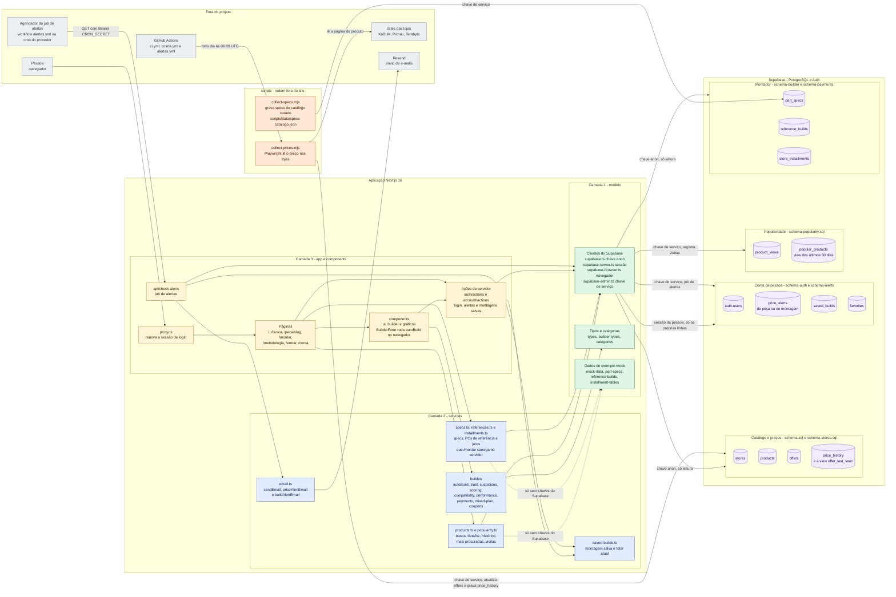
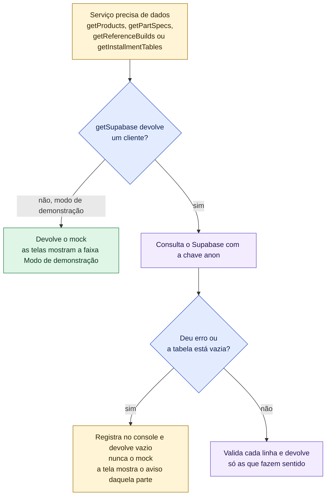
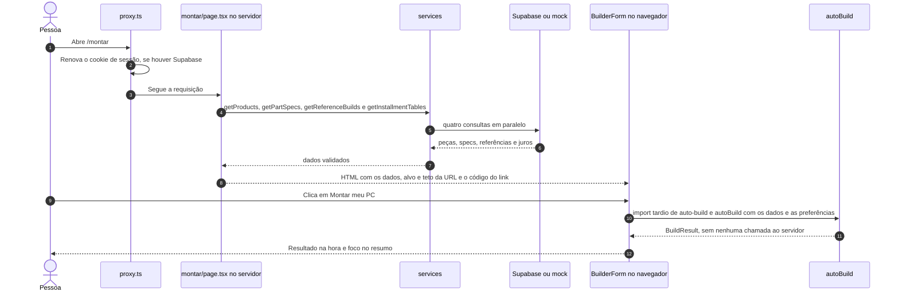

# Arquitetura do GarimpoPC

Visão de cima: de onde vêm os dados, por quais camadas eles passam até a tela e quais "robôs"
(coleta de preços e alertas) mexem no banco. O banco é o **Supabase** (PostgreSQL + login). Quando
as chaves do Supabase não estão configuradas, o site entra em **modo de demonstração** e usa dados
de exemplo guardados no código (o "mock").

> **Legenda**: amarelo = tela e componentes, azul = regras (services), verde = dados (models),
> roxo = banco de dados, laranja = robôs e scripts, cinza claro = fora do projeto.

## 1. Camadas, banco, coleta de preços e alertas

A regra de dependência é de baixo para cima: `models` não depende de `services`, `app` nem
`components`; `services` usa `models`; `app` e `components` usam `services` e `models`. Nenhum
arquivo de `models` ou `services` importa de `app` ou `components`. Uma exceção de desenho: login,
conta e alertas (`app/auth`, `app/account`, `/conta`, `/api/check-alerts`) falam direto com os
clientes do Supabase; a lógica pura deles (validar e serializar montagens, total atual da
montagem) fica em `services/saved-builds.ts`.

### Quem lê e quem grava cada tabela

| Tabela | Quem lê | Quem grava | Observação |
|---|---|---|---|
| `stores` | `products.ts` (junto com as ofertas), Montador (`isTrustedStore`/`storeTrust`) | seeds SQL (`seed.sql`, `seed-extras.sql`, `seed-stores.sql`) | `reclame_aqui_score`, `years_active` e `blocked` vêm do `schema-stores.sql`. Os valores do `seed-stores.sql` são de demonstração |
| `products` | `products.ts`, `popularity.ts`, `check-alerts` | seeds SQL | `featured` vem do `schema-popularity.sql` |
| `offers` | `products.ts`, `check-alerts`, `collect-prices.mjs`, `saveBuild` (confere a oferta antes de gravar) | `collect-prices.mjs` (atualiza só `price_pix`), seeds SQL | A coleta **não** atualiza `price_installment`, `installment_count` nem `in_stock` |
| `price_history` | `getPriceHistory` em `products.ts`; a view `offer_last_seen` | `collect-prices.mjs` (um ponto por oferta e por coleta), seeds SQL | Alimenta o gráfico de `/peca/[slug]`. `offer_last_seen` dá a hora da última leitura de cada oferta ("lido em DD/MM, HH:MM") |
| `price_alerts` | `/conta` (sessão da pessoa), `check-alerts` (chave de serviço) | `createAlert`, `createBuildAlert`, `deleteAlert` e `reactivateAlert` (sessão da pessoa); `check-alerts` (grava `notified_at` e desliga o alerta) | RLS: cada pessoa só vê as próprias linhas e só aponta para as próprias montagens. `saved_build_id` vem do `schema-alerts.sql` |
| `saved_builds` | `/conta` (sessão), `check-alerts` (chave de serviço) | `saveBuild` e `deleteSavedBuild` (sessão) | Nome até 60 caracteres, de 1 a 20 peças, até 50 montagens por pessoa |
| `favorites` | — | — | Tabela criada, mas nenhuma tela usa ainda |
| `product_views` | view `popular_products` | `registerView` (chave de serviço), em cada visita a `/peca/[slug]` | Sem deduplicação (pendência SEG-06) |
| `popular_products` | `getPopularProducts` (home) | — (é uma view) | Soma as visitas dos últimos 30 dias |
| `part_specs` | `getPartSpecs` → `/montar` | `collect-specs.mjs`, `seed-builder.sql` | Linha incompleta é descartada e contada no log |
| `reference_builds` | `getReferenceBuilds` → `/montar` | `seed-references.sql` | Os 12 PCs de referência; o seed é de demonstração |
| `store_installments` | `getInstallmentTables` → `/montar` | `seed-payments.sql` | Juros por loja; o seed é de demonstração |

---

## 2. Supabase × modo de demonstração

`getSupabase()` (em `src/models/supabase.ts`) devolve `null` quando faltam `NEXT_PUBLIC_SUPABASE_URL`
ou `NEXT_PUBLIC_SUPABASE_ANON_KEY`. A regra do projeto (`AGENTS.md`) é: **dado ilustrativo nunca vira
fato no modo real**. O mock só é usado quando não há banco. Com banco, um erro ou uma tabela vazia
devolve vazio, e a tela avisa.

O que muda sem Supabase, e o que acontece com banco quando falta dado:

| Área | Sem as chaves do Supabase | Com Supabase, mas erro ou tabela vazia |
|---|---|---|
| Catálogo (`getProducts`) | `MOCK_PRODUCTS` e `MOCK_HISTORY` | Lista vazia; `/montar` mostra "Catálogo vazio" |
| Specs (`getPartSpecs`) | `PART_SPECS` | `{}`; `/montar` mostra "Sem especificações cadastradas" e as peças são ignoradas |
| PCs de referência (`getReferenceBuilds`) | Os 12 de `REFERENCE_BUILDS` | `[]`; o painel de desempenho diz que não há referências e não mostra FPS |
| Juros (`getInstallmentTables`) | `INSTALLMENT_TABLES` | `{}`; vale o preço parcelado de cada oferta |
| Mais procuradas (`popularity.ts`) | As 6 primeiras peças do mock; `registerView` não faz nada | Destaques manuais (`featured`) ou as primeiras peças |
| Login (`/entrar`, `/conta`, salvar, alertas) | `getCurrentUser()` devolve `null`; `/entrar` avisa que o login não está configurado; `/conta` redireciona para `/entrar` | — |
| `/api/check-alerts` | Responde 503 sem `CRON_SECRET`, sem a chave de serviço ou, em produção, sem `RESEND_API_KEY` | — |
| Coleta de preços | `collect-prices.mjs` encerra com erro se faltarem as variáveis | — |

---

## 3. Onde cada parte roda: servidor × navegador

O servidor carrega os dados; o Montador faz os cálculos **no navegador**, por isso o resultado
aparece na hora. O código do algoritmo só é baixado quando a pessoa clica em "Montar meu PC".

Salvar a montagem e criar alertas chamam **ações de servidor** (`saveBuild`, `createBuildAlert`),
que exigem login, conferem no banco que cada oferta é daquela peça e gravam o preço que está no
banco, não o que veio do navegador.

## 4. Robôs: coleta de preços e alertas

| Robô | O que faz | Quando roda | Como protege |
|---|---|---|---|
| `scripts/collect-prices.mjs` | Abre a página de cada oferta com Playwright, lê o preço e grava `offers.price_pix` e um ponto em `price_history`, conferindo se a gravação deu certo. Só tem adaptadores para `kabum`, `pichau` e `terabyte` | Todo dia às 06:00 UTC pelo workflow `.github/workflows/coleta.yml`, ou à mão com `npm run collect` | Uma página por vez, pausa de 4 s entre elas, User-Agent identificado. Se mais de 30% das ofertas de uma loja falham, sai com código 2 e o workflow abre uma issue "Seletor quebrado" |
| `scripts/collect-specs.mjs` | Grava em `part_specs` as specs de peças que ainda não têm, a partir de `scripts/data/specs-catalogo.json` | À mão (`npm run collect:specs`) | Valida os valores antes de gravar; `--dry-run` não grava |
| `GET /api/check-alerts` | Procura alertas ativos ainda não avisados. Alerta de peça: compara o alvo com o melhor preço (`getBestOffer`). Alerta de montagem: compara com o total atual das peças salvas. Manda e-mail pelo Resend | Por um agendador **externo**: o workflow `.github/workflows/alertas.yml` (de hora em hora, segredos `SITE_URL` e `CRON_SECRET`) ou um cron do provedor de hospedagem | `CRON_SECRET` é obrigatório: sem ele a rota responde **503**; com token errado, **401** (comparação em tempo constante). Em produção, sem `RESEND_API_KEY` também responde 503. E-mail simulado não marca o alerta como avisado |
| `.github/workflows/ci.yml` | Confere tipos, lint, testes unitários, build e testes e2e a cada push | Em todo push e pull request | Roda em modo de demonstração, sem Supabase |

O fluxo completo do preço, da loja até o e-mail, está em [`fluxo-dados.md`](fluxo-dados.md).
