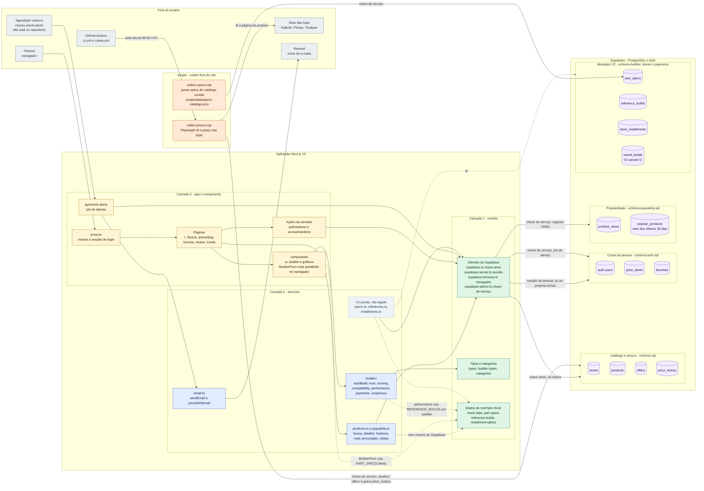
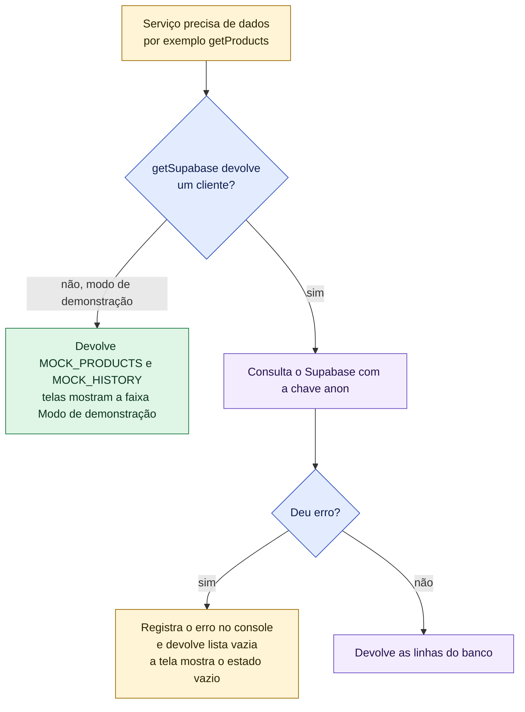
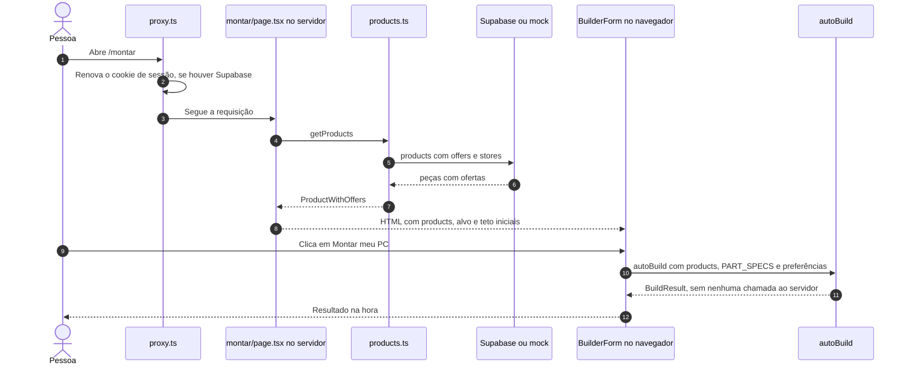

# Arquitetura do GarimpoPC

Visão de cima: de onde vêm os dados, por quais camadas eles passam até a tela e quais "robôs"
(coleta de preços e alertas) mexem no banco. O banco é o **Supabase** (PostgreSQL + login). Quando
as chaves do Supabase não estão configuradas, o site entra em **modo de demonstração** e usa dados
de exemplo guardados no código (o "mock").

> **Legenda**: amarelo = tela e componentes, azul = regras (services), verde = dados (models),
> roxo = banco de dados, laranja = robôs e scripts, cinza claro = fora do projeto,
> **cinza-azulado tracejado = V2 com código pronto, mas ainda não ligado às telas**.

## 1. Camadas, banco, coleta de preços e alertas

A regra de dependência é de baixo para cima: `models` não depende de `services`, `app` nem
`components`; `services` usa `models`; `app` e `components` usam `services` e `models`. Nenhum
arquivo de `models` ou `services` importa de `app` ou `components`. Uma exceção de desenho: login e
alertas (`app/auth`, `app/account`, `/conta`, `/api/check-alerts`) falam direto com os clientes do
Supabase, sem passar por um serviço.

### Quem lê e quem grava cada tabela

| Tabela | Quem lê | Quem grava | Observação |
|---|---|---|---|
| `stores` | `products.ts` (junto com as ofertas), Montador (`storeTrust`) | seeds SQL (`seed.sql`, `seed-extras.sql`, `seed-stores.sql`) | Colunas `reclame_aqui_score`, `years_active` e `blocked` vêm do `schema-stores.sql` (V2 pacote C) |
| `products` | `products.ts`, `popularity.ts`, `check-alerts` | seeds SQL | `featured` vem do `schema-popularity.sql` |
| `offers` | `products.ts`, `check-alerts`, `collect-prices.mjs` | `collect-prices.mjs` (atualiza só `price_pix`), seeds SQL | A coleta **não** atualiza `price_installment`, `installment_count` nem `in_stock` |
| `price_history` | `getPriceHistory` em `products.ts` | `collect-prices.mjs` (um ponto por oferta e por coleta), seeds SQL | Alimenta o gráfico de `/peca/[slug]` |
| `price_alerts` | `/conta` (sessão da pessoa), `check-alerts` (chave de serviço) | `createAlert` e `deleteAlert` (sessão da pessoa), `check-alerts` (preenche `notified_at`) | Protegida por RLS: cada pessoa só vê as próprias linhas |
| `favorites` | — | — | Tabela criada, mas nenhuma tela usa ainda |
| `product_views` | view `popular_products` | `registerView` (chave de serviço), em cada visita a `/peca/[slug]` | |
| `popular_products` | `getPopularProducts` (home) | — (é uma view) | Soma as visitas dos últimos 30 dias |
| `part_specs` | `getPartSpecs` (V2, não ligado à tela) | `collect-specs.mjs`, `seed-builder.sql` | Hoje `/montar` usa `PART_SPECS` do mock |
| `reference_builds` | `getReferenceBuilds` (V2, não ligado à tela) | `seed-builder.sql`, `seed-references.sql` | Hoje a tela usa `REFERENCE_BUILDS` do mock |
| `store_installments` | `getInstallmentTables` (V2, não ligado à tela) | `seed-payments.sql` | Juros por loja |
| `saved_builds` | — | — | **V2 pacote G**: tabela criada, sem código que a use |

---

## 2. Supabase × modo de demonstração

`getSupabase()` (em `src/models/supabase.ts`) devolve `null` quando faltam `NEXT_PUBLIC_SUPABASE_URL`
ou `NEXT_PUBLIC_SUPABASE_ANON_KEY`. Cada serviço decide o que fazer com esse `null`:

O que muda sem Supabase, por área:

| Área | Sem as chaves do Supabase |
|---|---|
| Catálogo (`products.ts`) | Usa `MOCK_PRODUCTS` e `MOCK_HISTORY` |
| Mais procuradas (`popularity.ts`) | Mostra as 6 primeiras peças do mock; `registerView` não faz nada |
| Montador (`/montar`) | Funciona normalmente com o catálogo e as specs do mock |
| Login (`/entrar`, `/conta`, botão de alerta) | `getCurrentUser()` devolve `null`; `/entrar` avisa que o login não está configurado; `/conta` redireciona para `/entrar` |
| `/api/check-alerts` | Responde 500 ("Supabase admin não configurado"), porque precisa da chave de serviço |
| Coleta de preços | `collect-prices.mjs` encerra com erro se faltarem as variáveis |

Um ponto de atenção: **com banco real, o catálogo vem do Supabase, mas as specs do Montador
ainda vêm do mock** (`PART_SPECS`). Peças novas do banco sem spec são ignoradas pela montagem. O
`getPartSpecs()` (V2 pacote A) resolve isso, mas ainda não está ligado à página `/montar`.

---

## 3. Onde cada parte roda: servidor × navegador

O Montador faz os cálculos **no navegador**. O servidor só entrega o catálogo.

## 4. Robôs: coleta de preços e alertas

| Robô | O que faz | Quando roda | Como protege |
|---|---|---|---|
| `scripts/collect-prices.mjs` | Abre a página de cada oferta com Playwright, lê o preço e grava `offers.price_pix` e um ponto em `price_history`. Só tem adaptadores para `kabum`, `pichau` e `terabyte`; ofertas de outras lojas são ignoradas | Todo dia às 06:00 UTC pelo workflow `.github/workflows/coleta.yml`, ou à mão com `npm run collect` | Uma página por vez, pausa de 4 s entre elas, User-Agent identificado. Se mais de 30% das ofertas de uma loja falham, sai com código 2 e o workflow abre uma issue "Seletor quebrado" |
| `scripts/collect-specs.mjs` | Grava em `part_specs` as specs de peças que ainda não têm, a partir de `scripts/data/specs-catalogo.json` | À mão (`node scripts/collect-specs.mjs`) | Valida os valores antes de gravar; `--dry-run` não grava |
| `GET /api/check-alerts` | Procura alertas ativos ainda não avisados, compara com o menor preço em estoque e manda e-mail pelo Resend | Quando o agendador externo chamar (o repositório **não** define esse agendador) | Cabeçalho `Authorization: Bearer <CRON_SECRET>`. **Se `CRON_SECRET` não estiver definido, a rota fica aberta** |
| `.github/workflows/ci.yml` | Confere tipos, lint, testes unitários, build e testes e2e a cada push | Em todo push e pull request | Roda em modo de demonstração, sem Supabase |

O fluxo completo do preço, da loja até o e-mail, está em [`fluxo-dados.md`](fluxo-dados.md).
