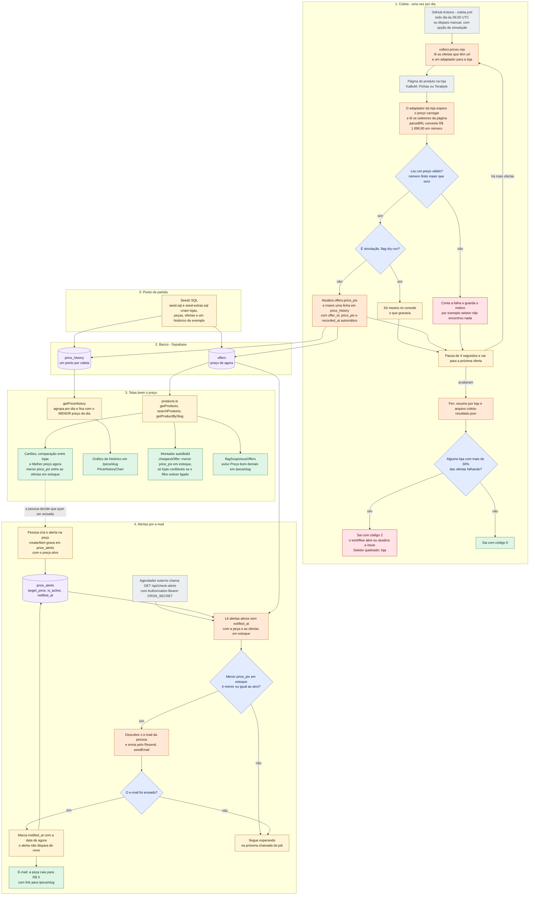
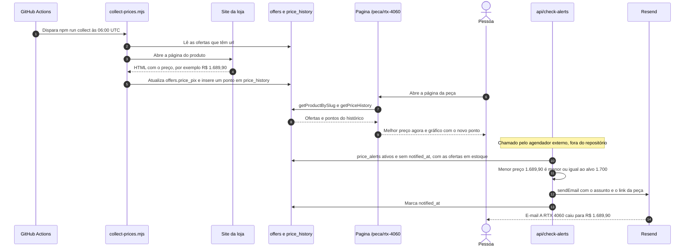
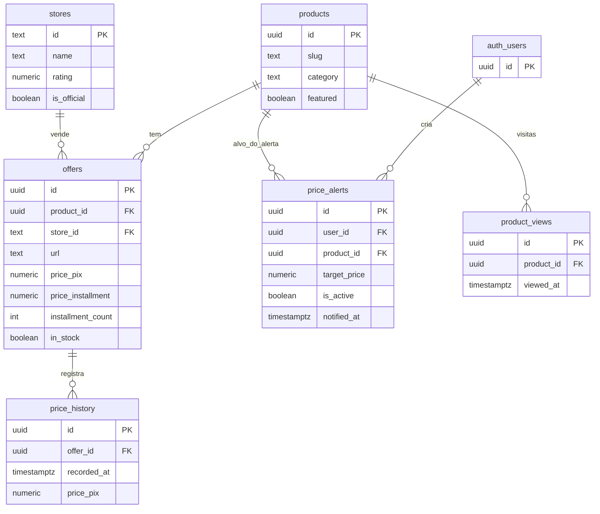

# O caminho de um preço: da loja ao e-mail de alerta

O dado mais valioso do GarimpoPC é o **preço**. Esta página segue um preço do começo ao fim:

1. A **loja** publica o preço na página do produto.
2. Um robô (**`scripts/collect-prices.mjs`**) lê essa página uma vez por dia.
3. O robô grava o preço atual na tabela **`offers`** e acrescenta um ponto na tabela **`price_history`**.
4. As **telas** leem essas tabelas: comparam lojas, desenham o gráfico de histórico e alimentam o Montador.
5. O **job de alertas** (`/api/check-alerts`) compara o preço atual com o que a pessoa pediu e manda um **e-mail** quando ele cai.

> **Legenda**: amarelo = passo, azul = decisão, laranja = robô, roxo = banco de dados, verde = resultado
> para a pessoa, cinza claro = fora do projeto.

## 1. Ciclo de vida do dado

## 2. Um exemplo, do começo ao fim (ilustrativo)

O preço abaixo é inventado para mostrar a sequência; a peça é a RTX 4060 do catálogo de exemplo
(KaBuM!, R$ 1.899,90 no Pix). A pessoa já criou um alerta para R$ 1.700.

## 3. Onde o preço mora (tabelas)

## 4. O que cada etapa muda

| Campo | Quem escreve | Quem lê | Observação |
|---|---|---|---|
| `offers.price_pix` | `collect-prices.mjs` (e os seeds) | Telas, Montador, `check-alerts` | É o preço "de agora" |
| `offers.price_installment` e `installment_count` | Só os seeds | Telas e Montador (pagamento) | **A coleta não atualiza**: o parcelado pode ficar defasado em relação ao Pix |
| `offers.in_stock` | Só os seeds | Telas, Montador, `check-alerts` | **A coleta não atualiza**: uma peça esgotada na loja continua "em estoque" no site |
| `price_history` | `collect-prices.mjs` (e os seeds) | `getPriceHistory` | Um ponto por oferta e por coleta; o gráfico usa o menor preço do dia |
| `price_alerts.target_price` | `createAlert` | `check-alerts`, `/conta` | Comparado com o preço Pix |
| `price_alerts.notified_at` | `check-alerts` | `check-alerts` | Vazio = ainda não avisou; preenchido = nunca mais avisa |

## 5. Lacunas do ciclo (o que o código faz hoje)

- **A coleta só atualiza o preço Pix.** Parcelado, número de parcelas e estoque nunca mudam depois do
  seed, o que afeta o plano de pagamento do Montador e a decisão do alerta.
- **Só há adaptadores para `kabum`, `pichau` e `terabyte`.** Ofertas de outras lojas (por exemplo, o
  marketplace do catálogo de exemplo) nunca são atualizadas pelo robô.
- **Quem chama `/api/check-alerts`?** O repositório só agenda a coleta de preços (`coleta.yml`). O
  agendador do job de alertas precisa ser configurado por fora, e a rota fica **aberta** se
  `CRON_SECRET` não estiver definido.
- **O alerta compara com a oferta mais barata de qualquer loja em estoque**, inclusive lojas que o site
  não considera confiáveis. Uma oferta de marketplace "boa demais" pode disparar o e-mail.
- **O gráfico de histórico também mistura todas as lojas** (menor preço do dia), sem aplicar o filtro
  de lojas confiáveis.
- **O alerta é de uso único.** Depois do aviso, `notified_at` fica preenchido e o alerta não dispara de
  novo, mas continua listado em `/conta` porque segue com `is_active` verdadeiro.
- **V2 pacote G**: a ideia de mostrar "preço de hoje às HH:MM" na montagem (`recorded_at` da oferta) e
  de avisar quando a **montagem inteira** cair ainda não existe no código.
