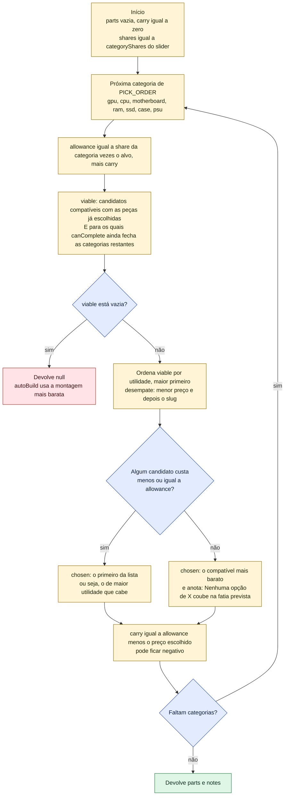
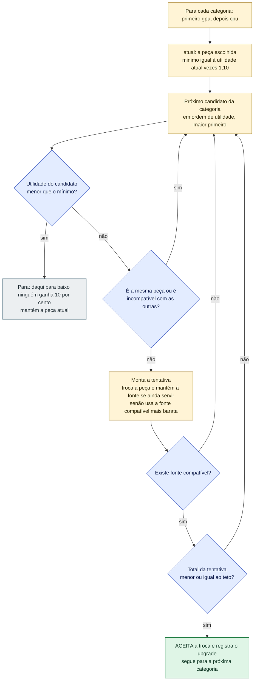
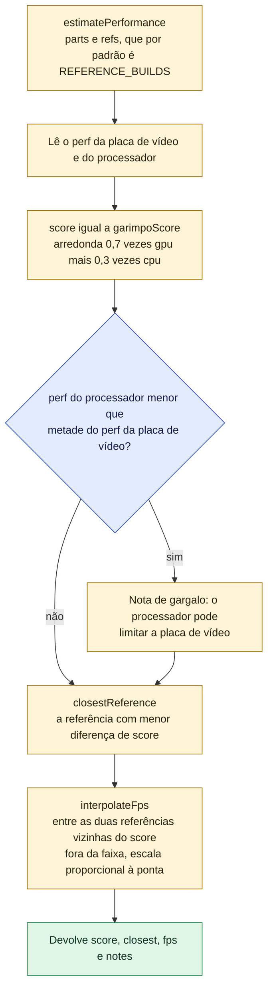

# Como o Montador decide as peças (`autoBuild`)

O Montador recebe um orçamento (alvo e teto) e devolve um PC completo: **7 peças compatíveis**,
uma de cada categoria, com o total **sempre menor ou igual ao teto**. Esta página explica o
algoritmo passo a passo. A fonte é `src/services/builder/auto-build.ts`; a especificação está
em `docs/superpowers/specs/2026-11-04-montador-de-pc-design.md` (§5 e §6).

Em linguagem simples, o algoritmo faz isto:

1. Descobre quais peças estão à venda (em lojas aceitas pelo filtro) e fica com a oferta mais barata de cada uma.
2. Confere se **existe** algum PC compatível que caiba no teto. Se não existe, avisa e para.
3. Divide o valor que a pessoa quer gastar (o **alvo**) em fatias por categoria e escolhe, em cada uma, a melhor peça que cabe.
4. Se, mesmo assim, passou do teto, troca peças por outras mais baratas até caber.
5. Se sobrou dinheiro (ou se a **folga** entre alvo e teto destrava algo bem melhor), sobe a placa de vídeo e depois o processador, mas só quando a melhora é de pelo menos 10%.
6. Calcula o desempenho esperado e o plano de pagamento.

> **Legenda**: amarelo = passo, azul = decisão, vermelho = falha, verde = sucesso, roxo = regra
> aplicada naquele passo, **cinza tracejado = V2 (ainda não existe)**.

---

## 1. Fluxo completo

```mermaid
flowchart TD
    classDef passo fill:#fff4d6,stroke:#9a6b00,color:#2b2200
    classDef decisao fill:#e3ecff,stroke:#2f4fbf,color:#0f1d4d
    classDef falha fill:#ffe3e6,stroke:#b3261e,color:#4a0d12
    classDef ok fill:#dff5e6,stroke:#1b7a3f,color:#0b3320
    classDef regra fill:#f3ecff,stroke:#6a4bc4,color:#22124d
    classDef v2 fill:#eeeeee,stroke:#777777,stroke-dasharray:5 5,color:#444444

    IN["Entrada<br/>products, specs e prefs<br/>prefs traz budget, trustedOnly e aesthetics"]:::passo
    IN --> P0["normalizeBudget<br/>o teto nunca fica menor que o alvo<br/>valores inválidos viram zero"]:::passo
    P0 --> P1["Passo 1 - buildCandidates<br/>só entram produtos que têm spec<br/>cheapestOffer escolhe a oferta em estoque<br/>mais barata no Pix"]:::passo
    R1["Regra: com trustedOnly só valem lojas<br/>oficiais com nota 4,5 ou mais"]:::regra
    R1 -.-> P1

    P1 --> D1{"As 7 categorias têm<br/>ao menos um candidato?"}:::decisao
    D1 -->|"não"| F1["FALHA<br/>Não há categoria disponível<br/>com os filtros atuais"]:::falha
    D1 -->|"sim"| P2["Passo 2 - cheapestCompatibleBuild<br/>para cada par CPU e GPU completa com a opção<br/>compatível mais barata das outras 5 categorias<br/>e guarda a de menor total"]:::passo
    P2 --> D2{"Achou alguma montagem<br/>compatível?"}:::decisao
    D2 -->|"não"| F2["FALHA<br/>Não encontramos uma combinação<br/>compatível de peças"]:::falha
    D2 -->|"sim"| D3{"Total da mais barata<br/>maior que o teto?"}:::decisao
    D3 -->|"sim"| F3["FALHA<br/>Orçamento insuficiente<br/>a mais barata compatível custa R$ N"]:::falha

    D3 -->|"não"| P3["Passo 3 - greedyPass<br/>uma categoria por vez, na ordem PICK_ORDER<br/>escolhe a peça de maior utilidade que cabe<br/>na fatia do alvo mais a sobra acumulada"]:::passo
    R2["Regras: fatias por categoria, utilidade pelo slider<br/>e compatibilidade de socket, DDR, gabinete e fonte"]:::regra
    R2 -.-> P3
    P3 --> D4{"greedyPass devolveu<br/>uma montagem?"}:::decisao
    D4 -->|"não, devolveu null"| P3b["Salvaguarda: usa a montagem<br/>mais barata do passo 2"]:::passo
    D4 -->|"sim"| D5
    P3b --> D5{"Total maior que o teto?"}:::decisao

    D5 -->|"sim"| P4["Passo 4 - downgradeToCap<br/>troca a peça mais cara que tenha alternativa<br/>compatível mais barata pela próxima mais barata<br/>e repete até caber"]:::passo
    P4 --> D6{"Ainda maior que o teto?"}:::decisao
    D6 -->|"sim"| P4b["Usa a montagem mais barata do passo 2<br/>e avisa: Para caber no teto, usamos<br/>a montagem compatível mais barata"]:::passo
    D6 -->|"não"| P5
    D5 -->|"não"| P5
    P4b --> P5

    P5["Passo 5 - upgradePass<br/>tenta subir a placa de vídeo e depois o processador<br/>usando sobras e folga até o teto"]:::passo
    R3["Regra: a troca só vale se a utilidade<br/>sobe 10 por cento ou mais, MIN_UPGRADE_GAIN igual a 1,10"]:::regra
    R3 -.-> P5
    P5 --> P6["Notas em linguagem simples<br/>Usou R$ X da folga, Sobrou dinheiro no alvo<br/>ou A montagem ficou R$ X acima do alvo"]:::passo
    P6 --> P7["toBuildParts<br/>ordena as peças na ordem de exibição DISPLAY_ORDER"]:::passo
    P7 --> P8["Passo 6a - buildPaymentSummary<br/>totais Pix e parcelado por loja"]:::passo
    P8 --> P9["Passo 6b - estimatePerformance<br/>Índice GarimpoPC, referência mais próxima e FPS"]:::passo
    P9 --> OUT["SUCESSO<br/>parts, totalPix, totalInstallment, budget,<br/>usedWiggleRoom igual a totalPix maior que alvo,<br/>leftover igual a teto menos totalPix,<br/>notes, performance e payment"]:::ok

    INV["Invariante testada:<br/>totalPix menor ou igual ao teto<br/>em todo resultado ok"]:::regra
    INV -.-> OUT

    X1["V2 pacote B<br/>otimização global por pares CPU e placa-mãe<br/>perfil de uso e resolução-alvo"]:::v2
    X2["V2 pacote A<br/>peça sem spec ignorada e contada em notes"]:::v2
    X3["V2 pacote C<br/>reputação com motivos e aviso de preço bom demais"]:::v2
    X1 -.-> P3
    X2 -.-> P1
    X3 -.-> P1
```



### Quatro camadas que garantem `total ≤ teto`

| Camada | Onde | O que faz |
|---|---|---|
| 1 | Passo 2, `cheapestCompatibleBuild` | Se nem a montagem mais barata cabe no teto, **nada é montado** (falha com o valor mínimo). |
| 2 | Passo 4, `downgradeToCap` | Rebaixa as peças mais caras, uma de cada vez, até caber. |
| 3 | Passo 4, salvaguarda | Se rebaixar não bastar, usa a montagem mais barata do passo 2, que já sabemos que cabe. |
| 4 | Passo 5, `upgradePass` | Só aceita uma troca para cima se o novo total (já com a fonte ajustada) continuar `≤ teto`. |

O teste `INVARIANTE: o total nunca passa do teto, em qualquer combinação` em `auto-build.test.ts`
confere 120 combinações (5 alvos × 4 valores de folga × 3 posições do slider × com e sem filtro
de lojas).

---

## 2. Passo 3 em detalhe: `greedyPass` (as fatias)

"Guloso" quer dizer que o algoritmo decide uma categoria de cada vez, sem voltar atrás. Quando
uma peça custa menos que a fatia, **a sobra passa para a próxima categoria**; quando custa mais
(só acontece com a opção mais barata), a sobra fica negativa e aperta as seguintes.



A **fonte (`psu`) é a última** porque a potência necessária depende do consumo da placa de vídeo
e do processador já escolhidos.

---

## 3. Passo 5 em detalhe: `upgradePass` (sobras e folga)

Aqui a folga entre alvo e teto pode ser usada. O algoritmo percorre os candidatos do melhor
para o pior e aceita o **melhor que cabe no teto**, não o mais barato.



Depois das trocas, `autoBuild` escreve a nota:

- se o total ficou **acima do alvo**: "Usou R$ X da folga para subir placa de vídeo: A → B (+N% de desempenho)";
- se ficou dentro do alvo: "Sobrou dinheiro no alvo e subimos placa de vídeo: A → B (+N%)";
- se não houve troca mas o guloso já tinha passado do alvo: "A montagem ficou R$ X acima do alvo, mas dentro do teto".

---

## 4. Passo 6b em detalhe: `estimatePerformance`



O `buildPaymentSummary` (passo 6a) tem página própria: [`fluxo-pagamento.md`](fluxo-pagamento.md).

---

## 5. Regras do algoritmo

### 5.1 Fatias do alvo por categoria (`categoryShares` em `scoring.ts`)

O slider "Desempenho ↔ Estética" (0 a 100) interpola linearmente entre duas colunas. Em cada
coluna as fatias somam 1.

| Categoria | Slider 0 (desempenho) | Slider 100 (estética) | Slider 25 (padrão da tela) |
|---|---|---|---|
| Placa de vídeo | 0,42 | 0,30 | 0,39 |
| Processador | 0,17 | 0,14 | 0,1625 |
| Placa-mãe | 0,13 | 0,12 | 0,1275 |
| Memória | 0,07 | 0,09 | 0,075 |
| Armazenamento | 0,08 | 0,07 | 0,0775 |
| Fonte | 0,08 | 0,08 | 0,08 |
| Gabinete | 0,05 | 0,20 | 0,0875 |

Ordem de escolha (`PICK_ORDER`): placa de vídeo, processador, placa-mãe, memória, armazenamento,
gabinete e, por último, fonte. Ordem de exibição na tela (`DISPLAY_ORDER`): a mesma, mas com a
fonte antes do gabinete.

### 5.2 Utilidade de uma peça (`partUtility` em `scoring.ts`)

A utilidade é uma nota de 0 a 1 que mistura desempenho e estética, conforme o slider:

```
w          = (slider / 100) × relevância da estética na categoria
utilidade  = (1 − w) × (perf ÷ maior perf da categoria) + w × (estética ÷ 100)
```

| Categoria | Relevância da estética |
|---|---|
| Gabinete | 1,0 |
| Memória | 0,8 |
| Placa de vídeo | 0,6 |
| Fonte | 0,3 |
| Placa-mãe | 0,3 |
| Processador | 0 |
| Armazenamento | 0 |

Por isso, mesmo no extremo estético, processador e SSD são escolhidos só por desempenho.
Empates se resolvem pelo menor preço e depois pelo `slug`.

### 5.3 Compatibilidade (`isCompatible` em `compatibility.ts`)

| Regra | Condição |
|---|---|
| Socket | `cpu.socket` igual a `motherboard.socket` |
| Memória | `ram.ramType` igual a `motherboard.ramType` (DDR4 ou DDR5) |
| Gabinete | `case.caseSupports` inclui o `motherboard.formFactor` |
| Fonte | `psu.wattage` maior ou igual a `ceil((tdp da GPU + tdp da CPU + 75) × 1,3)` |

Só pares em que as duas peças já foram escolhidas são verificados; o resto é aceito.

### 5.4 Ganho mínimo de 10% (`MIN_UPGRADE_GAIN = 1.1`)

Uma troca para cima só é aceita se a **utilidade** do candidato for pelo menos 1,10 vezes a da
peça atual. Com o slider em 0, a utilidade é proporcional ao desempenho, então "10% de utilidade"
significa "10% mais desempenho". Com o slider mais alto, a estética também conta. O "+N%"
escrito na nota é calculado só pelo desempenho (`perf`).

### 5.5 Resumo das funções reais

| Função | Arquivo | Papel |
|---|---|---|
| `autoBuild` | `auto-build.ts` | Orquestra tudo e devolve `BuildResult` |
| `normalizeBudget` | `budget.ts` | Garante teto maior ou igual ao alvo e números válidos |
| `buildCandidates` | `auto-build.ts` | Candidatos por categoria: produto + oferta mais barata + spec |
| `cheapestOffer` e `validOffers` | `trust.ts` | Filtram ofertas em estoque e, se pedido, só lojas confiáveis |
| `cheapestCompatibleBuild` | `auto-build.ts` | A montagem compatível mais barata possível |
| `canComplete` | `auto-build.ts` | Garante que a escolha atual não impede de fechar as categorias restantes |
| `categoryShares` e `partUtility` | `scoring.ts` | Fatias do alvo e utilidade de cada peça |
| `isCompatible` e `requiredWattage` | `compatibility.ts` | Regras de compatibilidade |
| `greedyPass` | `auto-build.ts` | Passo guloso por fatias |
| `downgradeToCap` | `auto-build.ts` | Rebaixa até caber no teto |
| `upgradePass` | `auto-build.ts` | Sobe GPU e CPU com sobras e folga |
| `estimatePerformance` | `performance.ts` | Índice, referência mais próxima e FPS |
| `buildPaymentSummary` | `payments.ts` | Totais Pix e parcelado por loja |

---

## 6. Exemplo numérico real

Os números abaixo vêm do **catálogo de exemplo** (`src/models/mock-data.ts`, preços
ilustrativos) e foram conferidos executando o próprio `autoBuild` em 04/11/2026. Os testes de
`auto-build.test.ts` cobrem os mesmos casos. Para reproduzir:
`npx vitest run src/services/builder/auto-build.test.ts` (11 testes, todos passam). Se o
catálogo de exemplo mudar, os valores mudam.

### 6.1 Passo a passo: alvo R$ 6.000, teto R$ 7.000, slider 0, só lojas confiáveis

**Passo 2 (existe montagem?)** A montagem compatível mais barata custa **R$ 4.699,30**
(RX 6600 + Ryzen 5 7600 + ASRock A620M + Vengeance 16 GB + Kingston NV2 + Corsair CV650 +
Rise Mode Galaxy). Como 4.699,30 é menor que o teto de 7.000, o algoritmo segue.

**Passo 3 (`greedyPass`)**: a "fatia" é a parcela do alvo reservada à categoria; o "limite" é a
fatia mais a sobra das categorias anteriores.

| # | Categoria | Fatia (parcela × R$ 6.000) | Sobra anterior | Limite | Peça escolhida (loja) | Preço Pix | Sobra depois | Por que essa |
|---|---|---|---|---|---|---|---|---|
| 1 | Placa de vídeo | 0,42 → 2.520,00 | 0,00 | 2.520,00 | RTX 4060 (KaBuM!) | 1.899,90 | 620,10 | RTX 4070 SUPER (4.299,90), RX 7700 XT (2.999,90) e RTX 4060 Ti (2.699,90) rendem mais, mas não cabem |
| 2 | Processador | 0,17 → 1.020,00 | 620,10 | 1.640,10 | Ryzen 5 7600 (KaBuM!) | 1.299,90 | 340,20 | Maior desempenho que cabe |
| 3 | Placa-mãe | 0,13 → 780,00 | 340,20 | 1.120,20 | ASRock A620M (Pichau) | 699,90 | 420,30 | A ASUS B650M (1.199,90) não cabe; a Gigabyte B760M é de outro socket |
| 4 | Memória | 0,07 → 420,00 | 420,30 | 840,30 | XPG Lancer 32 GB (KaBuM!) | 699,90 | 140,40 | A de 32 GB rende mais e cabe graças à sobra |
| 5 | Armazenamento | 0,08 → 480,00 | 140,40 | 620,40 | Kingston NV2 1 TB (Pichau) | 419,90 | 200,50 | O WD Black 2 TB (899,90) não cabe |
| 6 | Gabinete | 0,05 → 300,00 | 200,50 | 500,50 | Gamemax H605 (KaBuM!) | 279,90 | 220,60 | O Montech Sky Two (749,90) não cabe |
| 7 | Fonte | 0,08 → 480,00 | 220,60 | 700,60 | MSI MAG A750GL (KaBuM!) | 599,90 | 100,70 | Maior desempenho que cabe; 750 W atende os 332 W necessários |
| | | | | **Total do guloso** | | **5.899,30** | | Menor que o teto: o passo 4 não faz nada |

**Passo 5 (`upgradePass`)**, com teto de R$ 7.000:

| Categoria | Atual | Mínimo para valer (utilidade × 1,10) | Candidato | Utilidade | Total se trocar | Resultado |
|---|---|---|---|---|---|---|
| Placa de vídeo | RTX 4060, utilidade 100 ÷ 168 = 0,595 | 0,655 | RTX 4070 SUPER | 1,000 | 8.299,30 | Recusa: passa do teto |
| Placa de vídeo | idem | idem | RX 7700 XT | 0,845 | **6.999,30** | **Aceita**: cabe no teto; a fonte de 750 W continua servindo (precisa de 501 W) |
| Processador | Ryzen 5 7600, utilidade 1,00 (já é o melhor do catálogo) | 1,10 | nenhum | máximo 1,00 | — | Mantém |

**Resultado**

| Item | Valor |
|---|---|
| Total no Pix | R$ 6.999,30 |
| Total parcelado | R$ 7.839,23 |
| Sobra até o teto | R$ 0,70 (selo "No teto") |
| Usou a folga? | Sim, porque 6.999,30 passa do alvo de 6.000 |
| Nota | "Usou R$ 999,30 da folga para subir placa de vídeo: NVIDIA GeForce RTX 4060 8GB → AMD Radeon RX 7700 XT 12GB (+42% de desempenho)." |
| Índice GarimpoPC | round(0,7 × 142 + 0,3 × 100) = **129** |
| Referência mais próxima | "PC intermediário forte" (índice 129) |

### 6.2 Outros casos (o que cada entrada produz)

| Caso | Alvo / teto / slider / só confiáveis | Resultado | Onde está testado |
|---|---|---|---|
| Sem folga | 6.000 / 6.000 / 0 / sim | RTX 4060, total R$ 5.899,30, não usa folga | teste "usa a folga para subir a placa de vídeo" |
| Com folga | 6.000 / 7.000 / 0 / sim | RX 7700 XT, total R$ 6.999,30, usa folga | idem |
| Orçamento impossível | 1.000 / 1.000 / 25 / sim | Falha: "Orçamento insuficiente: a montagem mais barata compatível custa R$ 4.699,30" | teste "orçamento impossível falha dizendo o valor" |
| Montagem mais barata do catálogo | qualquer | R$ 4.699,30 | teste "a montagem mais barata compatível do catálogo custa R$ 4.699,30" |
| No limite do teto | 4.700 / 4.700 / 25 / sim | O guloso estoura, o rebaixamento não resolve e entra a salvaguarda: monta a mais barata (R$ 4.699,30) com a nota "Para caber no teto, usamos a montagem compatível mais barata" | execução do `autoBuild` |
| Filtro de lojas | 5.500 / 5.500 / 0 / não e sim | Sem filtro, a RTX 4060 vem do Promo Center por R$ 1.649,90; com filtro vem da KaBuM! por R$ 1.899,90 | teste "sem o filtro de lojas, aceita a oferta boa demais" |
| Estética máxima | 6.000 / 7.000 / 100 / sim | Escolhe o gabinete Montech Sky Two | teste "no extremo estético escolhe o gabinete bonito" |
| Teto igual ao alvo | 7.000 / 7.000 / 50 / sim | Nunca marca uso de folga | teste "teto igual ao alvo nunca marca uso de folga" |

### 6.3 Catálogo sintético dos testes (ganho de 10%)

No teste, o resto do PC custa R$ 1.700 e há três placas de vídeo: A (R$ 1.000, perf 100),
B (R$ 1.500, perf 105) e C (R$ 2.000, perf 120). Com o alvo de R$ 2.700 e slider 0, o guloso
escolhe a placa A (total R$ 2.700).

| Teto | Candidato testado | Ganho de utilidade sobre A | Total se trocar | Decisão |
|---|---|---|---|---|
| R$ 3.200 | B | 1,05 (5%) | R$ 3.200 | Recusa: o ganho é menor que 10%, mesmo cabendo no teto |
| R$ 3.200 | C | 1,20 (20%) | R$ 3.700 | Recusa: passa do teto |
| R$ 3.700 | C | 1,20 (20%) | R$ 3.700 | **Aceita**: cabe exatamente no teto e usa a folga |
