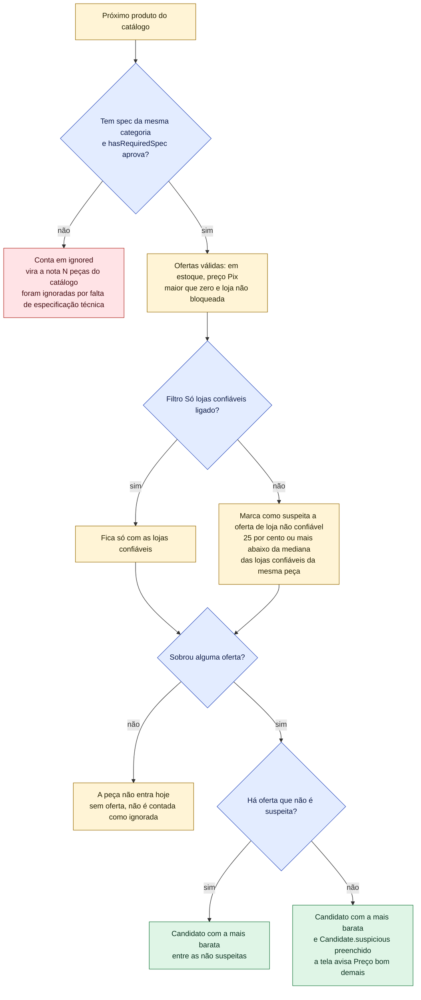
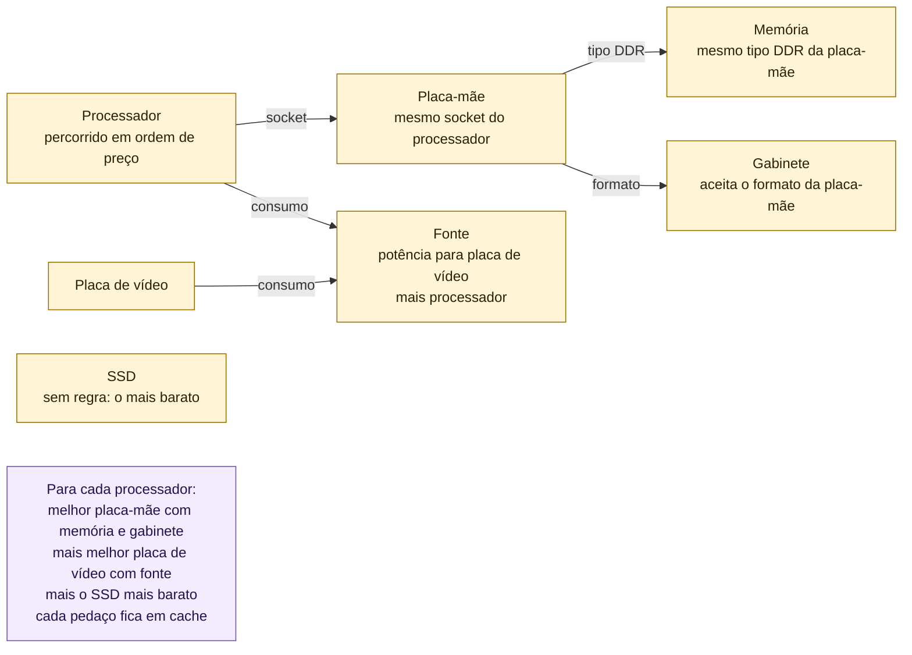
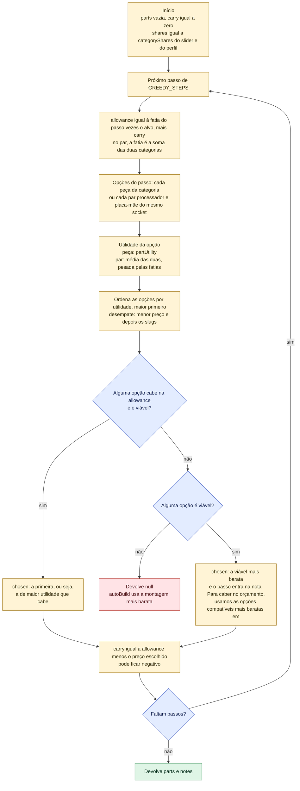
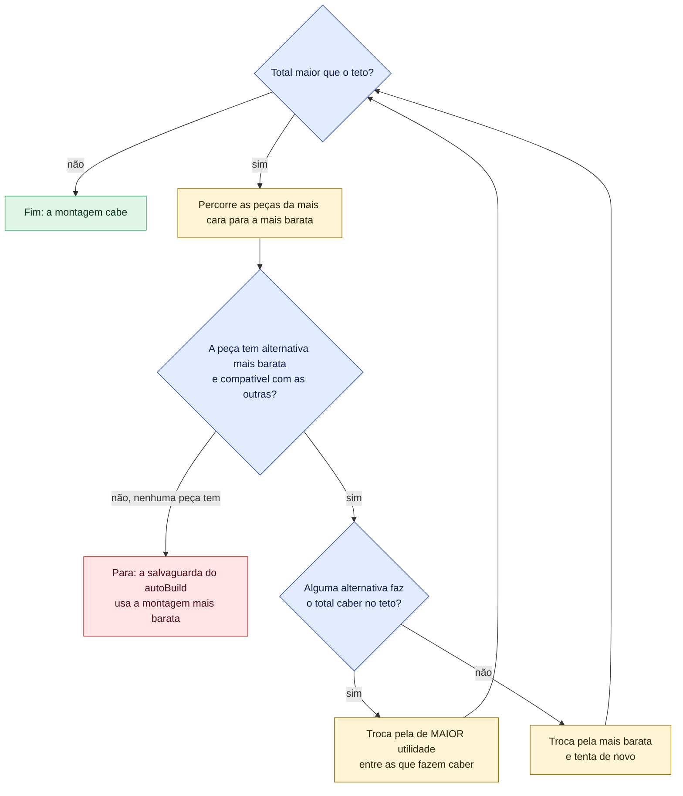
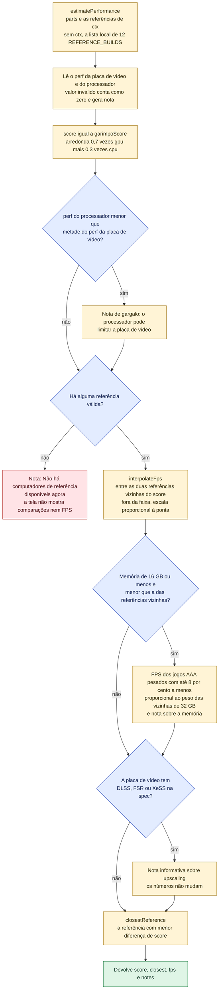

# Como o Montador decide as peças (`autoBuild`)

O Montador recebe um orçamento (alvo e teto) e devolve um PC completo: **7 peças compatíveis**,
uma de cada categoria, com o total **sempre menor ou igual ao teto**. Esta página explica o
algoritmo passo a passo. A fonte é `src/services/builder/auto-build.ts`; a especificação está
em `docs/superpowers/specs/2026-11-04-montador-de-pc-design.md` (§5 e §6).

Em linguagem simples, o algoritmo faz isto:

1. Separa as peças que podem entrar: precisam ter a ficha técnica completa e estar à venda numa
   loja aceita pelo filtro. Para cada peça, fica com a oferta mais barata **que não seja "boa
   demais"** (preço suspeito de golpe). Peças sem ficha técnica são contadas e viram um aviso.
2. Calcula a montagem compatível **mais barata possível** (de forma exata, sem chutar). Se nem
   ela cabe no teto, avisa quanto ela custa e para.
3. Divide o valor que a pessoa quer gastar (o **alvo**) em fatias por categoria e escolhe, em
   cada uma, a melhor peça que cabe. Processador e placa-mãe são escolhidos **juntos**, como um par.
4. Se, mesmo assim, passou do teto, troca a peça mais cara pela **melhor alternativa mais barata
   que faz caber**.
5. Se sobrou dinheiro (ou se a **folga** entre alvo e teto destrava algo bem melhor), sobe peças
   na ordem do **perfil de uso**: em jogos, primeiro a placa de vídeo; em criação, primeiro o
   processador; em trabalho, só o processador. A troca só vale se a melhora for de pelo menos 10%.
6. Calcula o desempenho esperado e o plano de pagamento.

> **Legenda**: amarelo = passo, azul = decisão, vermelho = falha, verde = sucesso, roxo = regra
> aplicada naquele passo, **cinza tracejado = ainda não existe (pendência pós-V2, ver
> `docs/PENDENCIAS-POS-V2.md`)**.

---

## 1. Fluxo completo

```mermaid
flowchart TD
    classDef passo fill:#fff4d6,stroke:#9a6b00,color:#2b2200
    classDef decisao fill:#e3ecff,stroke:#2f4fbf,color:#0f1d4d
    classDef falha fill:#ffe3e6,stroke:#b3261e,color:#4a0d12
    classDef ok fill:#dff5e6,stroke:#1b7a3f,color:#0b3320
    classDef regra fill:#f3ecff,stroke:#6a4bc4,color:#22124d
    classDef v2 fill:#eeeeee,stroke:#777777,stroke-dasharray:5 5,color:#444444

    IN["Entrada<br/>products, specs, prefs e ctx<br/>prefs: budget, trustedOnly, aesthetics, usage, resolution<br/>ctx: references e installmentTables vindos do servidor"]:::passo
    IN --> P0["normalizeBudget<br/>o teto nunca fica menor que o alvo<br/>valores inválidos viram zero"]:::passo
    P0 --> P1["Passo 1 - collectCandidates<br/>só entra peça com spec completa da mesma categoria<br/>e com oferta válida, a mais barata não suspeita<br/>peça sem spec vai para ignored"]:::passo
    R1["Regra de confiança: isTrustedStore<br/>oficial, nota 4,5 ou mais, Reclame Aqui 6 ou mais<br/>quando informado e nunca bloqueada"]:::regra
    R1 -.-> P1

    P1 --> D1{"As 7 categorias têm<br/>ao menos um candidato?"}:::decisao
    D1 -->|"não"| F1["FALHA<br/>Não há categoria disponível<br/>com os filtros atuais"]:::falha
    D1 -->|"sim"| P2["Passo 2 - planejador exato makePlanner<br/>a montagem compatível mais barata possível<br/>cheapestFrom confere tudo com allCompatible"]:::passo
    P2 --> D2{"Achou alguma montagem<br/>compatível?"}:::decisao
    D2 -->|"não"| F2["FALHA<br/>Não encontramos uma combinação<br/>compatível de peças"]:::falha
    D2 -->|"sim"| D3{"Total da mais barata<br/>maior que o teto?"}:::decisao
    D3 -->|"sim"| F3["FALHA<br/>Orçamento insuficiente<br/>a mais barata compatível custa R$ N"]:::falha

    D3 -->|"não"| P3["Passo 3 - greedyPass<br/>um passo por vez em GREEDY_STEPS<br/>placa de vídeo, par processador e placa-mãe,<br/>memória, SSD, gabinete e fonte"]:::passo
    R2["Regras: fatias do alvo pelo slider e pelo perfil,<br/>utilidade pelo slider, compatibilidade<br/>e o planejador diz se ainda dá para completar"]:::regra
    R2 -.-> P3
    P3 --> D4{"greedyPass devolveu<br/>uma montagem compatível?"}:::decisao
    D4 -->|"não"| P3b["Salvaguarda: usa a montagem<br/>mais barata do passo 2"]:::passo
    D4 -->|"sim"| D5
    P3b --> D5{"Total maior que o teto?"}:::decisao

    D5 -->|"sim"| P4["Passo 4 - downgradeToCap<br/>na peça mais cara com alternativa mais barata,<br/>escolhe a de MAIOR utilidade que faz caber no teto<br/>se nenhuma faz caber, a mais barata, e repete"]:::passo
    P4 --> D6{"Ainda maior que o teto?"}:::decisao
    D6 -->|"sim"| P4b["Usa a montagem mais barata do passo 2<br/>e avisa: Para caber no teto, usamos<br/>a montagem compatível mais barata"]:::passo
    D6 -->|"não"| P5
    D5 -->|"não"| P5
    P4b --> P5

    P5["Passo 5 - upgradePass<br/>sobe peças usando sobras e folga até o teto<br/>na ordem do perfil de uso"]:::passo
    R3["Ordem da folga por perfil<br/>jogos: placa de vídeo e depois processador<br/>criação: processador e depois placa de vídeo<br/>trabalho: só o processador<br/>ganho mínimo de 10 por cento, MIN_UPGRADE_GAIN 1,10"]:::regra
    R3 -.-> P5
    P5 --> P6["Notas em linguagem simples<br/>Subimos a placa de vídeo: A para B, por mais R$ X<br/>e quanto disso veio da folga"]:::passo
    P6 --> P7["toBuildParts<br/>ordena as peças na ordem de exibição DISPLAY_ORDER"]:::passo
    P7 --> P8["Avisos<br/>suspicionNotes para peça de oferta suspeita<br/>e N peças ignoradas por falta de especificação"]:::passo
    P8 --> P9["Passo 6a - buildPaymentSummary<br/>com as tabelas de juros de ctx<br/>ver fluxo-pagamento.md"]:::passo
    P9 --> P10["Passo 6b - estimatePerformance<br/>com as referências de ctx<br/>Índice GarimpoPC, referência mais próxima, FPS e notas"]:::passo
    P10 --> OUT["SUCESSO<br/>parts, totalPix, totalInstallment, budget,<br/>usedWiggleRoom, leftover, notes,<br/>upgrades, ignored, performance e payment"]:::ok

    INV["Invariantes testadas:<br/>totalPix menor ou igual ao teto,<br/>só lojas confiáveis com o filtro ligado<br/>e peças compatíveis"]:::regra
    INV -.-> OUT

    X1["Pendência pós-V2 - pacote B<br/>otimização global, por exemplo busca em feixe,<br/>e resolução mudando a montagem"]:::v2
    X1 -.-> P3
```



### Quatro camadas que garantem `total ≤ teto`

| Camada | Onde | O que faz |
|---|---|---|
| 1 | Passo 2, planejador exato | Se nem a montagem mais barata cabe no teto, **nada é montado** (falha com o valor mínimo). |
| 2 | Passo 4, `downgradeToCap` | Rebaixa a peça mais cara, escolhendo a melhor alternativa que faz caber, até caber. |
| 3 | Passo 4, salvaguarda | Se rebaixar não bastar, usa a montagem mais barata do passo 2, que já sabemos que cabe. |
| 4 | Passo 5, `upgradePass` | Só aceita uma troca para cima se o novo total (já com a fonte ajustada) continuar `≤ teto`. |

Os testes de `auto-build.test.ts` conferem a invariante em 120 combinações fixas do catálogo de
exemplo (5 alvos × 4 folgas × 3 posições do slider × com e sem filtro de lojas), em 200
preferências aleatórias sobre um catálogo sintético de 150 peças por categoria e, para a
montagem mais barata, contra força bruta.

---

## 2. Passo 1 em detalhe: `collectCandidates`

Para cada produto do catálogo, uma pergunta de cada vez. O resultado é a lista de candidatos de
cada categoria e a contagem `ignored` (peças deixadas de fora por falta de ficha técnica).



Com a regra atual, a oferta de uma loja confiável nunca é suspeita. Então o caso "só sobrou a
suspeita" só acontece com o filtro desligado e quando a peça não tem oferta confiável em estoque
que não seja ela. Ele é testado com um detector injetado (`check`, último parâmetro de
`collectCandidates`).

---

## 3. Passo 2 em detalhe: o planejador exato (`makePlanner`)

Testar todas as combinações seria impossível: com 150 peças por categoria são 150⁷ montagens.
As regras de compatibilidade formam uma **árvore** em volta do processador, e isso permite achar
a montagem mais barata **exata** em poucos milissegundos (o teste de 150 peças por categoria
roda em menos de 200 ms).



O mesmo planejador responde, no passo 3, a pergunta "com estas peças já escolhidas, ainda dá para
completar uma montagem compatível?" (`podeCompletar`). Assim o guloso nunca escolhe uma peça que
deixaria outra categoria sem opção. Se uma regra nova de compatibilidade ligar outras categorias
(por exemplo, comprimento da placa de vídeo no gabinete), o planejador precisa mudar junto
(pendência A-2).

---

## 4. Passo 3 em detalhe: `greedyPass` (as fatias)

"Guloso" quer dizer que o algoritmo decide um passo de cada vez, sem voltar atrás. Quando uma
escolha custa menos que a fatia, **a sobra passa para o próximo passo**; quando custa mais (só
acontece com a opção mais barata), a sobra fica negativa e aperta os seguintes.

Os passos (`GREEDY_STEPS`) são seis: placa de vídeo; **processador + placa-mãe juntos**; memória;
SSD; gabinete; fonte. O par existe porque escolher o processador mais barato sozinho pode obrigar
a uma placa-mãe cara de outro socket, e o par inteiro sair mais caro que outro par.



"Viável" quer dizer: compatível com o que já foi escolhido **e** o planejador ainda consegue
completar a montagem com essa escolha. A **fonte é a última** porque a potência necessária depende
do consumo da placa de vídeo e do processador já escolhidos.

---

## 5. Passo 4 em detalhe: `downgradeToCap` (rebaixamento até o teto)

Só roda quando o guloso passou do teto. Ele não pega "a próxima mais barata" às cegas: entre as
alternativas mais baratas e compatíveis, fica com a **de maior utilidade que já faz o total caber**.
Isso evita ficar com uma peça pior **e** mais cara do que outra opção que também cabia.



Exemplo do teste (catálogo sintético): placas de vídeo A (R$ 3.000, perf 120), B (R$ 2.900,
perf 95) e C (R$ 2.500, perf 100); processador R$ 2.000 + placa-mãe R$ 1.500 (único par); resto
R$ 800; alvo = teto = R$ 7.200. O guloso pega A, e o total fica em R$ 7.300. B e C fazem caber
(R$ 7.200 e R$ 6.800). O rebaixamento escolhe **C**, que rende mais que B e custa menos. Antes da
correção (F-02), ele ficava com B, a "próxima mais barata".

---

## 6. Passo 5 em detalhe: `upgradePass` (sobras e folga)

Aqui a folga entre alvo e teto pode ser usada. A **ordem** das categorias segue o perfil de uso
(`upgradeOrder` em `scoring.ts`):

| Perfil (`prefs.usage`) | Ordem da subida | Por quê |
|---|---|---|
| Jogos (padrão) | placa de vídeo, depois processador | A placa de vídeo manda nos FPS |
| Criação | processador, depois placa de vídeo | Edição e render dependem mais do processador, mas a placa ainda ajuda |
| Trabalho | só o processador | Estudo e escritório não ganham nada com uma placa de vídeo maior |

Em cada categoria, o algoritmo percorre os candidatos do melhor para o pior e aceita o **melhor
que cabe no teto**, não o mais barato.


Depois das trocas, `autoBuild` escreve as notas (textos reais):

- uma por troca: "Subimos a placa de vídeo: A → B, por mais R$ X (+N% de desempenho)." Se a fonte
  também mudou, entra ", já contando a troca da fonte". Se o desempenho não sobe, a nota diz
  "(mesmo desempenho, visual melhor)" ou "(visual melhor, N% menos desempenho)";
- se as peças já passavam do alvo antes das trocas: "Antes das trocas, as peças já passavam R$ X do
  alvo (dentro do teto).";
- se as trocas fizeram o total passar do alvo: "No total, as trocas usaram R$ X da folga (acima do
  alvo, dentro do teto)" e, se parte do preço veio da sobra dentro do alvo, "; o resto veio do que
  sobrou dentro do alvo.";
- se não houve troca, mas o guloso já passou do alvo: "A montagem ficou R$ X acima do alvo, mas
  dentro do teto."

`usedWiggleRoom` (o selo "Usou a folga") só é verdadeiro quando **houve troca E o total passou do
alvo**. Um total acima do alvo sem troca aparece como "Acima do alvo, dentro do teto".

---

## 7. Passo 6b em detalhe: `estimatePerformance`



De onde vêm as referências: no modo de demonstração (sem Supabase), da lista local de 12 PCs
(`src/models/reference-builds.ts`). Com Supabase, só do banco (`getReferenceBuilds`): erro ou tabela
vazia devolvem **lista vazia** e a tela mostra a nota acima, sem inventar comparação. A tela também
mostra "PCs parecidos com o seu" (`closestReferences`, as 3 mais próximas) e um link para
`/metodologia`. O `buildPaymentSummary` (passo 6a) tem página própria: [`fluxo-pagamento.md`](fluxo-pagamento.md).

---

## 8. Regras do algoritmo

### 8.1 Fatias do alvo por categoria (`categoryShares` em `scoring.ts`)

O slider "Desempenho ↔ Estética" (0 a 100) interpola linearmente entre duas colunas. Em cada
coluna as fatias somam 1.

| Categoria | Slider 0 (desempenho) | Slider 100 (estética) | Slider 25 (padrão da tela) |
|---|---|---|---|
| Placa de vídeo | 0,42 | 0,30 | 0,39 |
| Processador | 0,17 | 0,14 | 0,1625 |
| Placa-mãe | 0,13 | 0,12 | 0,1275 |
| Memória | 0,07 | 0,09 | 0,075 |
| Armazenamento | 0,08 | 0,07 | 0,0775 |
| Fonte | 0,08 | 0,08 | 0,08 |
| Gabinete | 0,05 | 0,20 | 0,0875 |

Depois da interpolação, o **perfil de uso** soma um ajuste. Cada linha soma zero, então as fatias
continuam somando 1:

| Perfil | Placa de vídeo | Processador | Memória | Armazenamento |
|---|---|---|---|---|
| Jogos | 0 | 0 | 0 | 0 |
| Trabalho | −0,12 | +0,05 | +0,03 | +0,04 |
| Criação | −0,06 | +0,05 | +0,04 | −0,03 |

Ordem de escolha (`GREEDY_STEPS`): placa de vídeo; processador + placa-mãe; memória; armazenamento;
gabinete; fonte. Ordem de exibição na tela (`DISPLAY_ORDER`): placa de vídeo, processador,
placa-mãe, memória, armazenamento, fonte e gabinete.

### 8.2 Utilidade de uma peça (`partUtility` em `scoring.ts`)

A utilidade é uma nota de 0 a 1 que mistura desempenho e estética, conforme o slider:

```
w          = (slider / 100) × relevância da estética na categoria
utilidade  = (1 − w) × (perf ÷ maior perf da categoria) + w × (estética ÷ 100)
```

| Categoria | Relevância da estética |
|---|---|
| Gabinete | 1,0 |
| Memória | 0,8 |
| Placa de vídeo | 0,6 |
| Fonte | 0,3 |
| Placa-mãe | 0,3 |
| Processador | 0 |
| Armazenamento | 0 |

Por isso, mesmo no extremo estético, processador e SSD são escolhidos só por desempenho.
Empates se resolvem pelo menor preço e depois pelo `slug`. A utilidade do **par** processador +
placa-mãe é a média das duas, pesada pelas fatias de cada uma:
`(fatia_cpu × u_cpu + fatia_placa × u_placa) ÷ (fatia_cpu + fatia_placa)`.

### 8.3 Compatibilidade (`isCompatible` e `hasRequiredSpec` em `compatibility.ts`)

| Regra | Condição |
|---|---|
| Socket | `cpu.socket` igual a `motherboard.socket` |
| Memória | `ram.ramType` igual a `motherboard.ramType` (DDR4 ou DDR5) |
| Gabinete | `case.caseSupports` inclui o `motherboard.formFactor` |
| Fonte | `psu.wattage` maior ou igual a `ceil((tdp da GPU + tdp da CPU + 75) × 1,3)` |

`isCompatible` só verifica pares em que as duas peças já foram escolhidas. Por isso o Montador só
aceita peças com a ficha completa (`hasRequiredSpec`): placa de vídeo e processador precisam de
`tdp` e `perf` maiores que zero, o processador de `socket`, a placa-mãe de `socket`, `ramType` e
`formFactor`, a memória de `ramType`, o gabinete de `caseSupports`, a fonte de `wattage` e o SSD de
`perf`; todas precisam de categoria conhecida e `aesthetics` entre 0 e 100.

### 8.4 Ganho mínimo de 10% (`MIN_UPGRADE_GAIN = 1.1`)

Uma troca para cima só é aceita se a **utilidade** do candidato for pelo menos 1,10 vezes a da
peça atual (com utilidade atual zero, exige só que seja maior). Com o slider em 0, a utilidade é
proporcional ao desempenho, então "10% de utilidade" significa "10% mais desempenho". Com o
slider mais alto, a estética também conta. O "+N%" escrito na nota é calculado só pelo
desempenho (`perf`).

### 8.5 Resumo das funções reais

| Função | Arquivo | Papel |
|---|---|---|
| `autoBuild` | `auto-build.ts` | Orquestra tudo e devolve `BuildResult` |
| `normalizeBudget` | `budget.ts` | Garante teto maior ou igual ao alvo e números válidos |
| `collectCandidates` | `auto-build.ts` | Candidatos por categoria, peças ignoradas (`ignored`) e oferta suspeita (`Candidate.suspicious`) |
| `buildCandidates` | `auto-build.ts` | Atalho de `collectCandidates` que devolve só os candidatos |
| `validOffers` e `cheapestOffer` | `trust.ts` | Ofertas em estoque, com preço maior que zero, de loja não bloqueada e, se pedido, só confiáveis |
| `isTrustedStore` e `storeTrust` | `trust.ts` | A régua de confiança (a mesma para o filtro e para o selo) e os motivos em linguagem simples |
| `suspiciousPrice` e `flagSuspiciousOffers` | `suspicious.ts` | Oferta 25% ou mais abaixo da mediana das lojas confiáveis |
| `makePlanner` e `cheapestCompatibleBuild` | `auto-build.ts` | A montagem compatível mais barata, exata, e "ainda dá para completar?" |
| `categoryShares` e `partUtility` | `scoring.ts` | Fatias do alvo (slider e perfil) e utilidade de cada peça |
| `upgradeOrder` | `scoring.ts` | Ordem da subida com a folga por perfil: jogos placa de vídeo e processador, criação processador e placa de vídeo, trabalho só processador |
| `isCompatible`, `hasRequiredSpec` e `requiredWattage` | `compatibility.ts` | Regras de compatibilidade e ficha mínima |
| `greedyPass` | `auto-build.ts` | Passo guloso por fatias, com o par processador + placa-mãe |
| `downgradeToCap` | `auto-build.ts` | Rebaixa até caber no teto, pela alternativa de maior utilidade que faz caber |
| `upgradePass` | `auto-build.ts` | Sobe peças com sobras e folga, na ordem do perfil de uso |
| `suspicionNotes` | `auto-build.ts` | Um aviso por peça que veio de oferta "boa demais" |
| `estimatePerformance` e `closestReferences` | `performance.ts` | Índice, referência mais próxima, "PCs parecidos", FPS e notas (gargalo, memória, upscaling) |
| `buildPaymentSummary` | `payments.ts` | Totais Pix e a prazo por loja, parcelas e parcelado mais barato |

---

## 9. Exemplo numérico real

Os números abaixo vêm do **catálogo de exemplo** (`src/models/mock-data.ts`, preços
ilustrativos) e foram conferidos executando o próprio `autoBuild` em 04/11/2026. Para
reproduzir: `npx vitest run src/services/builder/auto-build.test.ts`. Se o catálogo de exemplo
mudar, os valores mudam.

### 9.1 Passo a passo: alvo R$ 6.000, teto R$ 7.000, slider 0, perfil Jogos, só lojas confiáveis

**Passo 1.** Nenhuma peça ignorada (as 20 do exemplo têm ficha completa) e nenhuma oferta suspeita
escolhida.

**Passo 2 (existe montagem?)** A montagem compatível mais barata custa **R$ 4.699,30**
(RX 6600 + Ryzen 5 7600 + ASRock A620M + Vengeance 16 GB + Kingston NV2 + Corsair CV650 +
Rise Mode Galaxy). Como 4.699,30 é menor que o teto de 7.000, o algoritmo segue.

**Passo 3 (`greedyPass`)**: a "fatia" é a parcela do alvo reservada ao passo; o "limite" é a
fatia mais a sobra dos passos anteriores.

| # | Passo | Fatia (parcela × R$ 6.000) | Sobra anterior | Limite | Escolha (loja) | Preço Pix | Sobra depois | Por que essa |
|---|---|---|---|---|---|---|---|---|
| 1 | Placa de vídeo | 0,42 → 2.520,00 | 0,00 | 2.520,00 | RTX 4060 (KaBuM!) | 1.899,90 | 620,10 | RTX 4070 SUPER (4.299,90), RX 7700 XT (2.999,90) e RTX 4060 Ti (2.699,90) rendem mais, mas não cabem |
| 2 | Processador + placa-mãe | 0,30 → 1.800,00 | 620,10 | 2.420,10 | Core i5-14400F (Terabyte) + Gigabyte B760M (KaBuM!) | 2.149,80 | 270,30 | O par Ryzen 5 7600 + ASUS B650M (2.499,80) não cabe. Entre os que cabem, o par Intel tem utilidade 0,93 contra 0,91 do Ryzen 5 7600 + ASRock A620M |
| 3 | Memória | 0,07 → 420,00 | 270,30 | 690,30 | Vengeance 16 GB (KaBuM!) | 349,90 | 340,40 | A XPG Lancer 32 GB (699,90) passa do limite por R$ 9,60 |
| 4 | Armazenamento | 0,08 → 480,00 | 340,40 | 820,40 | Kingston NV2 1 TB (Pichau) | 419,90 | 400,50 | O WD Black 2 TB (899,90) não cabe |
| 5 | Gabinete | 0,05 → 300,00 | 400,50 | 700,50 | Gamemax H605 (KaBuM!) | 279,90 | 420,60 | O Montech Sky Two (749,90) não cabe |
| 6 | Fonte | 0,08 → 480,00 | 420,60 | 900,60 | MSI MAG A750GL (KaBuM!) | 599,90 | 300,70 | Maior desempenho que cabe; 750 W atende os 390 W necessários |
| | | | | **Total do guloso** | | **5.699,30** | | Menor que o teto: o passo 4 não faz nada |

**Passo 5 (`upgradePass`)**, perfil Jogos (placa de vídeo, depois processador), teto de R$ 7.000:

| Categoria | Atual | Mínimo para valer (utilidade × 1,10) | Candidato | Utilidade | Total se trocar | Resultado |
|---|---|---|---|---|---|---|
| Placa de vídeo | RTX 4060, utilidade 100 ÷ 168 = 0,595 | 0,655 | RTX 4070 SUPER | 1,000 | 8.099,30 | Recusa: passa do teto |
| Placa de vídeo | idem | idem | RX 7700 XT | 0,845 | **6.799,30** | **Aceita**: cabe no teto; a fonte de 750 W continua servindo (precisa de 559 W) |
| Processador | Core i5-14400F, utilidade 0,92 | 1,012 | Ryzen 5 7600 | 1,000 | — | Mantém: o ganho é menor que 10% |

**Resultado**

| Item | Valor |
|---|---|
| Total no Pix | R$ 6.799,30 |
| Total a prazo (preço parcelado das ofertas) | R$ 7.615,23 |
| Sobra até o teto | R$ 200,70 |
| Usou a folga? | Sim: houve troca e 6.799,30 passa do alvo de 6.000 (selo "Usou a folga") |
| Notas | "Subimos a placa de vídeo: NVIDIA GeForce RTX 4060 8GB → AMD Radeon RX 7700 XT 12GB, por mais R$ 1.100,00 (+42% de desempenho)." e "No total, as trocas usaram R$ 799,30 da folga (acima do alvo, dentro do teto); o resto veio do que sobrou dentro do alvo." |
| Índice GarimpoPC | round(0,7 × 142 + 0,3 × 92) = **127** |
| Referência mais próxima | "PC intermediário forte" |
| Notas de desempenho | "16 GB de memória: jogos pesados podem engasgar; 32 GB dá folga. Já descontamos 8% dos FPS de jogos AAA pesados." e "Com FSR, os FPS podem subir bastante em 1440p. As estimativas não contam esse ganho." |

O pagamento desta montagem está em [`fluxo-pagamento.md`](fluxo-pagamento.md), seção 3.

### 9.2 Outros casos (o que cada entrada produz)

| Caso | Alvo / teto / slider / perfil / só confiáveis | Resultado |
|---|---|---|
| Sem folga | 6.000 / 6.000 / 0 / Jogos / sim | RTX 4060, total R$ 5.699,30, sem troca e sem nota de folga |
| Com folga | 6.000 / 7.000 / 0 / Jogos / sim | RX 7700 XT, total R$ 6.799,30, "Usou a folga" (seção 9.1) |
| Orçamento impossível | 1.000 / 1.000 / 25 / Jogos / sim | Falha: "Orçamento insuficiente: a montagem mais barata compatível custa R$ 4.699,30. Suba o teto ou desative “Só lojas confiáveis”." |
| No limite do teto | 4.700 / 4.700 / 25 / Jogos / sim | Monta a mais barata (R$ 4.699,30) com a nota "Para caber no orçamento, usamos as opções compatíveis mais baratas em: processador, placa-mãe, memória RAM, armazenamento, gabinete e fonte." |
| Filtro de lojas desligado | 6.000 / 7.000 / 0 / Jogos / não | A RTX 4060 continua vindo da KaBuM! (R$ 1.899,90). A oferta de R$ 1.399,90 do Promo Center (marketplace) é "boa demais" e nunca é recomendada em silêncio |
| Estética máxima | 6.000 / 7.000 / 100 / Jogos / sim | Escolhe o gabinete Montech Sky Two |
| Teto igual ao alvo | 7.000 / 7.000 / 50 / Jogos / sim | Nunca marca uso de folga |
| Perfil Trabalho | qualquer, com folga | A folga nunca troca a placa de vídeo; só o processador pode subir |

### 9.3 Catálogo sintético dos testes (ganho de 10%)

No teste, o resto do PC custa R$ 1.700 e há três placas de vídeo: A (R$ 1.000, perf 100),
B (R$ 1.500, perf 105) e C (R$ 2.000, perf 120). Com o alvo de R$ 2.700 e slider 0, o guloso
escolhe a placa A (total R$ 2.700).

| Teto | Candidato testado | Ganho de utilidade sobre A | Total se trocar | Decisão |
|---|---|---|---|---|
| R$ 3.200 | B | 1,05 (5%) | R$ 3.200 | Recusa: o ganho é menor que 10%, mesmo cabendo no teto |
| R$ 3.200 | C | 1,20 (20%) | R$ 3.700 | Recusa: passa do teto |
| R$ 3.700 | C | 1,20 (20%) | R$ 3.700 | **Aceita**: cabe exatamente no teto e usa a folga |
