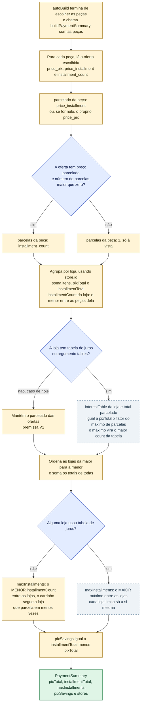
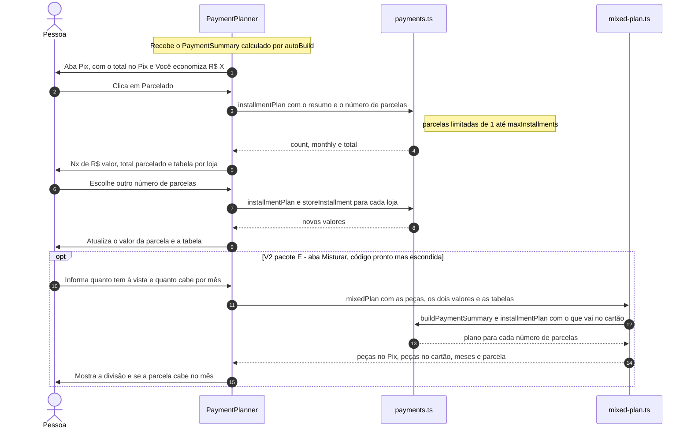
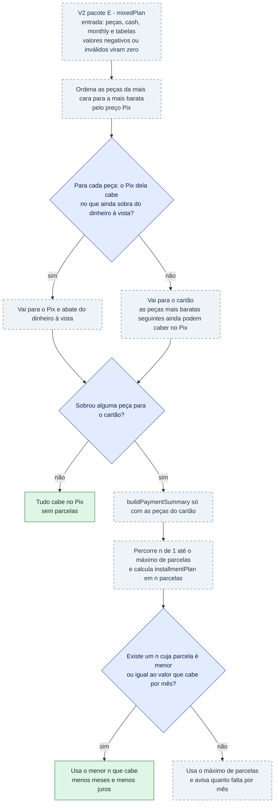

# Pix × parcelado: como o site calcula o pagamento

Depois de montar o PC, a pessoa quer saber **quanto vai pagar e como**. O GarimpoPC mostra duas
opções: **Pix** (à vista, geralmente mais barato) e **parcelado** (no cartão, normalmente com
valor total maior). Há um detalhe importante que a tela repete: **cada loja é um pagamento
separado**. Se o PC tem peças de 3 lojas, são 3 compras, e os totais da tela somam as três.

As contas ficam em `src/services/builder/payments.ts` (e `mixed-plan.ts`, `coupons.ts`); a tela é
`src/components/builder/PaymentPlanner.tsx`. A especificação é o §7 de
`docs/superpowers/specs/2026-11-04-montador-de-pc-design.md`.

> **Legenda**: amarelo = passo que roda hoje, azul = decisão, verde = resultado, roxo = regra,
> **cinza tracejado = V2 que ainda não existe**, **cinza-azulado tracejado = V2 com código pronto
> (pacote E), mas ainda não ligado à tela**.

## O que roda hoje e o que é V2

| Recurso | Estado | Onde |
|---|---|---|
| Totais Pix e parcelado por loja, economia no Pix, seletor de parcelas | **Funciona hoje** (premissa V1: o preço parcelado da loja vale para qualquer número de parcelas até o máximo dela) | `buildPaymentSummary`, `installmentPlan` |
| Tabela de juros por loja (`InstallmentRate`), plano por loja, "sem juros até Nx" | **V2 pacote E: código pronto, não ligado.** `autoBuild` chama `buildPaymentSummary(buildParts)` sem tabelas, e nada na pasta `src/app` chama `getInstallmentTables()` | `rateFor`, `interestFreeUpTo`, `storeInstallment`, `src/services/installments.ts` |
| Aba "Misturar" (parte no Pix, parte no cartão) | **V2 pacote E: código pronto, escondida.** A aba só aparece se `PaymentPlanner` receber `parts`, e `BuildResultView` ainda não as passa (depende do pacote F) | `mixedPlan`, `Misturar` |
| Cupons de desconto | **V2 pacote E: só a lógica.** Não há tabela `coupons`, serviço nem campo de cupom na tela | `applyCoupon` em `coupons.ts` |
| Cashback | **V2: ainda não existe** | — |

---

## 1. Como o resumo de pagamento é calculado

Regras gerais: todos os valores são arredondados em centavos (`round2`); preço parcelado nulo conta
como à vista; contagem de parcelas 0 ou nula conta como 1.

---

## 2. O que acontece na tela "Como pagar"

O que a pessoa vê em cada aba:

| Aba | Mostra | Detalhe |
|---|---|---|
| Pix (à vista) | Total no Pix | "Você economiza R$ X em relação ao parcelado" só aparece se `pixSavings` for maior que zero |
| Parcelado | "Nx de R$ valor", total parcelado e seletor de 1x até `maxInstallments` | Sem tabela de juros: "Limitado pela loja que parcela em menos vezes". O texto "Acréscimo de R$ X (N%) em relação ao Pix" ou "Sem juros: mesmo preço do Pix" aparece em qualquer caso |
| Misturar (V2, escondida) | Duas caixas, "No Pix" e "No cartão", e uma caixa de resumo "Cabe no seu orçamento" ou "Ainda não cabe por mês" | Campos "Tenho à vista" e "Cabe por mês" |
| Tabela por loja (sempre) | Loja, itens, total Pix e parcelado | "só à vista" se a loja não parcela; com tabela, mostra também "sem juros até Nx" e o acréscimo |

---

## 3. Exemplo numérico real (catálogo de exemplo)

Montagem do exemplo de [`fluxo-montador.md`](fluxo-montador.md): alvo R$ 6.000, teto R$ 7.000,
slider 0, só lojas confiáveis. Valores obtidos executando as funções reais em 04/11/2026.

### 3.1 O que a tela mostra hoje (V1, sem tabela de juros)

| Loja | Itens | Total Pix | Total parcelado | Máx. parcelas |
|---|---|---|---|---|
| Pichau | 3 | R$ 4.119,70 | R$ 4.614,07 | 10 |
| KaBuM! | 4 | R$ 2.879,60 | R$ 3.225,16 | 10 |
| **Soma** | 7 | **R$ 6.999,30** | **R$ 7.839,23** | **10** |

Você economiza no Pix: R$ 7.839,23 − R$ 6.999,30 = **R$ 839,93**.

| Parcelas escolhidas | Parcela | Total |
|---|---|---|
| 1x | R$ 7.839,23 | R$ 7.839,23 |
| 5x | R$ 1.567,85 | R$ 7.839,23 |
| 10x | R$ 783,92 | R$ 7.839,23 |
| 12x | limitado a 10x: R$ 783,92 | R$ 7.839,23 |

Repare na premissa V1: parcelar em 1x ou em 10x custa o mesmo total, o que na vida real
raramente acontece. É por isso que a V2 traz a tabela de juros.

### 3.2 Como ficaria com as tabelas de juros (V2 pacote E, valores ilustrativos)

Usando `INSTALLMENT_TABLES` de `src/models/installment-tables.ts` (KaBuM!: até 10x sem juros e
11x a 12x com 6% a mais; Pichau: até 12x sem juros; Terabyte: 5% a mais em qualquer parcelamento
até 10x; Promo Center: 15% a mais até 12x):

| Parcelas | Pichau (Pix R$ 4.119,70) | KaBuM! (Pix R$ 2.879,60) | Parcela somada | Total |
|---|---|---|---|---|
| 6x | R$ 686,62 | R$ 479,93 | R$ 1.166,55 | R$ 6.999,30 (sem juros) |
| 10x | R$ 411,97 | R$ 287,96 | R$ 699,93 | R$ 6.999,30 (sem juros) |
| 11x | R$ 374,52 | R$ 277,49 | R$ 652,01 | R$ 7.172,08 |
| 12x | R$ 343,31 | R$ 254,37 | R$ 597,68 | R$ 7.172,08 (+ R$ 172,78, só na KaBuM!) |

Com tabela, o máximo geral sobe para 12x (o **maior** entre as lojas) e a economia no Pix cai
de R$ 839,93 para R$ 172,78, porque o parcelado deixa de ser um preço inventado pela oferta e
passa a seguir a regra de cada loja.

### 3.3 Mistura Pix + cartão (V2 pacote E, aba escondida)

Entrada: **R$ 3.000 à vista** e **R$ 400 por mês**.

| Passo | Resultado |
|---|---|
| Pix: peças mais caras primeiro, enquanto o dinheiro à vista der | RX 7700 XT (R$ 2.999,90), que sozinha cabe nos R$ 3.000 |
| Cartão: as outras 6 peças, no menor número de parcelas cuja parcela caiba em R$ 400 | 10x de R$ 399,94, total R$ 3.999,40 |
| Com tabelas de juros | "O parcelamento sai sem juros: mesmo preço do Pix." Cabe no orçamento |
| Sem tabelas (dados V1 das ofertas) | 10x de R$ 447,93: não cabe ("Falta R$ 47,93 por mês") |

---

## 4. Regras da V2 pacote E (código pronto)

| Regra | Como funciona | Função |
|---|---|---|
| Fator por parcelas | Usa a **menor faixa que cobre** o número de parcelas pedido. Entre faixas usa a de cima (a mais cara). Acima da maior faixa usa a maior. Tabela vazia = fator 1 | `rateFor` |
| Total em n parcelas | `pixTotal da loja × fator`. O fator nunca é menor que 1 (o banco e o serviço descartam linhas com fator menor) | `storeInstallment` |
| Sem juros até | Maior número de parcelas com fator 1 | `interestFreeUpTo` |
| Parcela somada | Soma o plano de cada loja. Se uma loja termina antes, as últimas parcelas ficam menores | `installmentPlan` |
| Tabelas no banco | `store_installments(store_id, count, factor)`, leitura pública. Sem Supabase usa o mock; com erro no banco devolve vazio, para não esconder juros reais atrás de juros de exemplo | `supabase/schema-payments.sql`, `getInstallmentTables` |
| Cupom | Desconto em % ou valor fixo, na loja ou na montagem toda; confere validade, valor mínimo e nunca desconta mais que o total daquela loja | `applyCoupon` |
