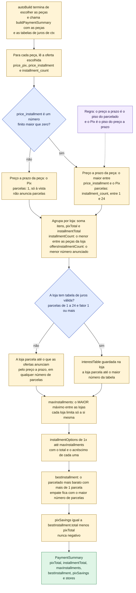
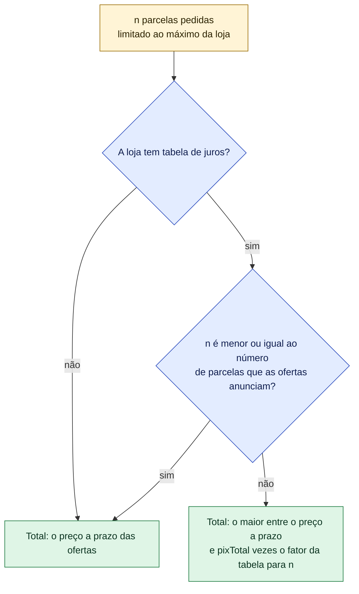
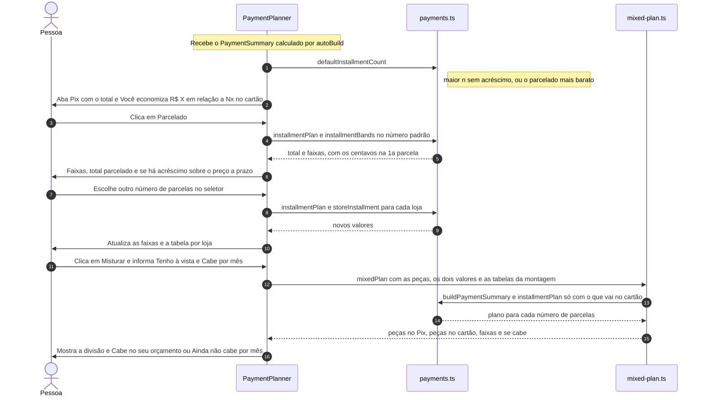
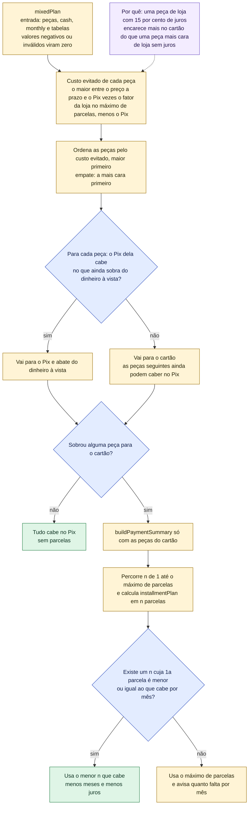

# Pix × parcelado: como o site calcula o pagamento

Depois de montar o PC, a pessoa quer saber **quanto vai pagar e como**. O GarimpoPC mostra três
opções: **Pix** (à vista, geralmente mais barato), **Parcelado** (no cartão) e **Misturar** (parte
no Pix, parte no cartão). Há um detalhe importante que a tela repete: **cada loja é um pagamento
separado**. Se o PC tem peças de 3 lojas, são 3 compras, e os totais da tela somam as três.

A regra de dinheiro que manda em tudo: no Brasil, "10x sem juros" vale sobre o **preço a prazo**
que a loja anuncia, e esse preço já é maior que o do Pix (o desconto só existe no Pix). Por isso o
site **nunca** mostra um parcelado mais barato que o preço a prazo anunciado, e nunca mostra o
cartão mais barato que o Pix.

As contas ficam em `src/services/builder/payments.ts` e `mixed-plan.ts`; a tela é
`src/components/builder/PaymentPlanner.tsx`. As tabelas de juros vêm de
`src/services/installments.ts`. A especificação é o §7 de
`docs/superpowers/specs/2026-11-04-montador-de-pc-design.md`.

> **Legenda**: amarelo = passo, azul = decisão, verde = resultado, roxo = regra,
> **cinza tracejado = ainda não existe (pendência pós-V2)**, **cinza-azulado tracejado = código
> pronto, mas sem tela**.

## O que está no ar

| Recurso | Estado | Onde |
|---|---|---|
| Totais Pix e a prazo por loja, seletor de parcelas, economia no Pix | **No ar** | `buildPaymentSummary`, `installmentPlan`, `installmentOptions` |
| Tabela de juros por loja | **No ar.** `/montar` carrega `getInstallmentTables()` e passa pelo `BuildContext` até `buildPaymentSummary(parts, tables)`. Sem Supabase usa o mock; com Supabase, erro ou tabela vazia devolvem `{}` (e vale o preço parcelado da oferta) | `rateFor`, `getInstallmentTables` |
| Preço a prazo como piso e "sem acréscimo até Nx" | **No ar.** Até o número de parcelas que a oferta anuncia vale o preço a prazo; a tabela só decide acima disso, e nunca abaixo do preço a prazo | `storeInstallment`, `storeNoExtraUpTo` |
| Faixas ("10x de R$ X + 2x de R$ Y") | **No ar.** Cada loja limita só as próprias parcelas; os centavos vão na 1ª parcela | `installmentBands`, `formatSchedule` |
| Parcelado mais barato e onde o seletor abre | **No ar** | `bestInstallment`, `defaultInstallmentCount` |
| Aba "Misturar" | **No ar** (visível sempre que há peças) | `mixedPlan`, `Misturar` em `PaymentPlanner.tsx` |
| Parcelado de uma oferta ("ou 10x de R$ X") | **No ar.** A lista de peças, a página da peça e o CSV usam a mesma conta | `offerInstallment` |
| Cupons de desconto | **Código pronto, sem tela.** Não há tabela `coupons` nem campo de cupom | `applyCoupon` em `coupons.ts` |
| Cashback e mistura ótima | **Ainda não existem** (pendências E-2 a E-4) | — |

---

## 1. Como o resumo de pagamento é calculado (`buildPaymentSummary`)

### 1.1 Total de uma loja em n parcelas

Exemplo: a peça da Terabyte diz "ou 10x de R$ 128,78", e a tabela de exemplo da Terabyte diz
"até 6x pelo preço a prazo; 7x a 10x, Pix + 15%". Como a oferta **anuncia** 10x, a loja cobra o
preço a prazo até 10x, e o seletor mostra "sem acréscimo" até 10x. A tabela só valeria acima de
10x, mas a Terabyte não parcela além disso.

Regras gerais: todos os valores são arredondados em centavos; parcelas fora de 1..24 e fatores
menores que 1 são descartados (no serviço e no banco); o resto da divisão de cada loja vai na 1ª
parcela, para a soma das parcelas fechar exatamente o total.

---

## 2. O que acontece na tela "Como pagar"

O que a pessoa vê em cada aba:

| Aba | Mostra | Detalhe |
|---|---|---|
| Pix (à vista) | Total no Pix | "Você economiza R$ X em relação a Nx no cartão, o parcelado mais barato." Só aparece se `pixSavings` for maior que zero |
| Parcelado | Faixas (ex.: "10x de R$ 663,48 + 2x de R$ 534,70"), total parcelado, quanto é a mais que o Pix e se há acréscimo sobre o preço a prazo | O seletor vai de 1x até `maxInstallments`, cada opção com "sem acréscimo" ou "+R$ X". Abre no maior número sem acréscimo; se todas têm acréscimo, no parcelado mais barato |
| Misturar | Campos "Tenho à vista (R$)" e "Cabe por mês (R$)", caixas "No Pix" e "No cartão" e o resumo "Cabe no seu orçamento" ou "Ainda não cabe por mês" | O dinheiro à vista vai primeiro para as peças que mais encarecem no cartão |
| Tabela por loja (sempre) | Loja, itens, Pix e a prazo, com "Nx de R$ Y" ou "só à vista" | Com tabela, também "sem acréscimo até Nx" e "+R$ X em Nx" |

---

## 3. Exemplo numérico real (catálogo de exemplo)

Montagem do exemplo de [`fluxo-montador.md`](fluxo-montador.md) (seção 9.1): alvo R$ 6.000, teto
R$ 7.000, slider 0, perfil Jogos, só lojas confiáveis. Valores obtidos executando as funções reais
em 04/11/2026 com as tabelas de juros de exemplo (`src/models/installment-tables.ts`): KaBuM! até
10x pelo preço a prazo e 11x a 12x com Pix + 16%; Pichau até 12x pelo preço a prazo; Terabyte até
6x pelo preço a prazo e 7x a 10x com Pix + 15%.

### 3.1 Por loja

| Loja | Itens | Total Pix | Preço a prazo | Parcelas anunciadas | Máx. parcelas | Sem acréscimo até |
|---|---|---|---|---|---|---|
| Pichau | 2 | R$ 3.419,80 | R$ 3.830,18 | 10 | 12 | 12x |
| KaBuM! | 4 | R$ 2.229,60 | R$ 2.497,16 | 10 | 12 | 10x |
| Terabyte Shop | 1 | R$ 1.149,90 | R$ 1.287,89 | 10 | 10 | 10x |
| **Soma** | 7 | **R$ 6.799,30** | **R$ 7.615,23** | | **12** | |

### 3.2 O seletor de parcelas

| Parcelas | O que a tela mostra | Total | Acréscimo sobre o preço a prazo |
|---|---|---|---|
| 1x | 1x de R$ 7.615,23 | R$ 7.615,23 | sem acréscimo |
| 6x | 6x de R$ 1.269,19 (+ centavos na 1ª) | R$ 7.615,23 | sem acréscimo |
| **10x (abre aqui)** | 10x de R$ 761,50 (+ centavos na 1ª) | R$ 7.615,23 | sem acréscimo |
| 11x | 10x de R$ 712,09 + 1x de R$ 583,31 | R$ 7.704,41 | +R$ 89,18 (só a KaBuM!) |
| 12x | 10x de R$ 663,48 + 2x de R$ 534,70 | R$ 7.704,41 | +R$ 89,18 (só a KaBuM!) |

- O seletor **abre em 10x**: é o maior número de parcelas sem acréscimo.
- Em 11x e 12x a Terabyte fica em 10x (é o máximo dela). Por isso as últimas parcelas são menores.
- O parcelado mais barato com mais de 1 parcela é 10x por R$ 7.615,23, então a aba Pix diz
  "Você economiza **R$ 815,93** em relação a 10x no cartão".
- Sem as tabelas de juros (modo real com `store_installments` vazia), cada loja vai até o que as
  ofertas anunciam (10x aqui), sempre pelo preço a prazo. Uma loja que só aceita Pix fica em 1x e
  **não** derruba o carrinho inteiro para 1x.

### 3.3 Mistura Pix + cartão

Entrada: **R$ 3.000 à vista** e **R$ 400 por mês**.

| Passo | Resultado |
|---|---|
| Pix: as peças que mais encarecem no cartão primeiro, enquanto o dinheiro à vista der | RX 7700 XT (R$ 2.999,90), que sozinha cabe nos R$ 3.000 |
| Cartão: as outras 6 peças, no menor número de parcelas cuja 1ª parcela caiba em R$ 400 | 12x: "10x de R$ 383,49 + 2x de R$ 254,71", total R$ 4.344,52. Em 10x ou 11x, a 1ª parcela passaria de R$ 400 |
| Notas da tela | "Pague R$ 2.999,90 no Pix (1 peça) e parcele o resto em 10x de R$ 383,49 + 2x de R$ 254,71.", "No cartão essas peças custam R$ 545,12 a mais do que no Pix." e "Desse valor, R$ 89,18 é acréscimo da loja acima do preço a prazo anunciado." |

---

## 4. Regras em uma tabela

| Regra | Como funciona | Função |
|---|---|---|
| Preço a prazo da oferta | `price_installment` válido (número finito maior que zero), nunca abaixo do Pix. Sem ele, a oferta entra pelo Pix e não parcela | `validInstallmentPrice` |
| Parcelas da oferta | `installment_count` entre 1 e 24; sem preço a prazo válido, 1x | `parcelasDaOferta` |
| Até o anunciado, preço a prazo | Até o menor número de parcelas anunciado pelas ofertas da loja, o total é o preço a prazo, mesmo que a tabela diga outra coisa | `totalDaLoja` |
| Acima do anunciado, a tabela | Total em n parcelas = o maior entre o preço a prazo e `pixTotal × fator(n)`. A tabela só encarece | `totalDaLoja`, `rateFor` |
| Fator por parcelas | A menor faixa que cobre n; entre faixas, a de cima (a mais cara); acima da maior faixa, a maior. Tabela vazia = fator 1 | `rateFor` |
| Máximo de parcelas | Por loja: o maior número da tabela, ou o que as ofertas anunciam. Geral: o **maior** entre as lojas, sempre | `maximoDaLoja`, `buildPaymentSummary` |
| Faixas | Soma o plano de cada loja; quem termina antes deixa as últimas parcelas menores | `installmentPlan`, `installmentBands` |
| Sem acréscimo até | Maior número de parcelas em que a loja cobra só o preço a prazo | `storeNoExtraUpTo` |
| Parcelado mais barato | O plano mais barato com mais de 1 parcela (empate: o maior n). É a base de "Você economiza" | `bestInstallment` |
| Onde o seletor abre | No maior número de parcelas sem acréscimo; se todas têm acréscimo, no parcelado mais barato | `defaultInstallmentCount` |
| Limites | Parcelas de 1 a 24 em ofertas, tabelas e banco (`check (count between 1 and 24)`) | `MAX_INSTALLMENTS` |
| Tabelas no banco | `store_installments(store_id, count, factor)`, leitura pública. Sem Supabase usa o mock; com erro ou tabela vazia devolve `{}`, para não esconder juros reais atrás de juros de exemplo | `supabase/schema-payments.sql`, `getInstallmentTables` |
| Cupom (sem tela) | Desconto em % ou valor fixo, na loja ou na montagem toda; confere validade, valor mínimo e nunca desconta mais que o total daquela loja | `applyCoupon` |
