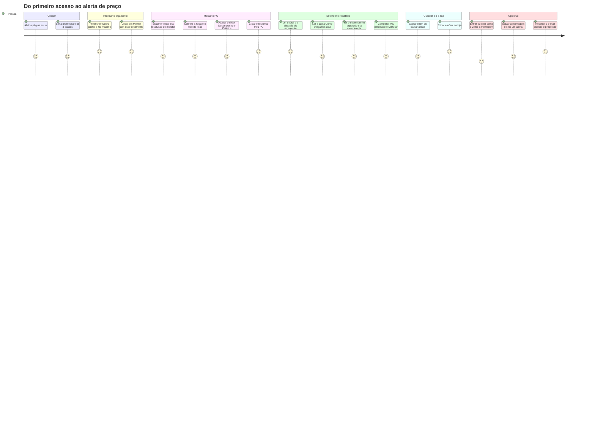
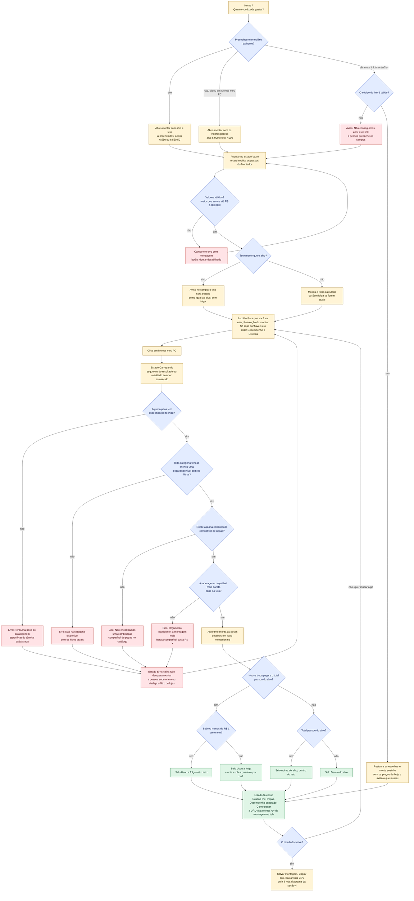
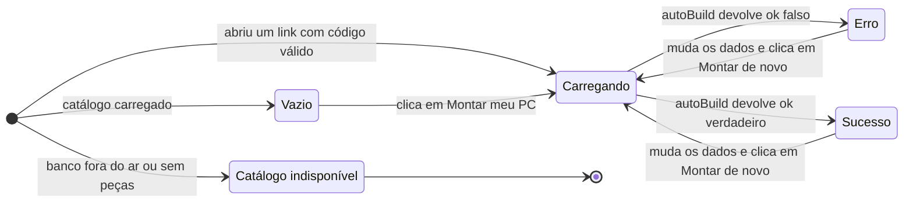
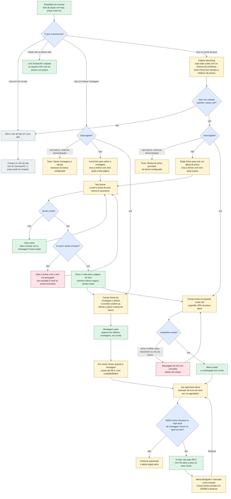

# Jornada da pessoa leiga

Quem é a pessoa: alguém que sabe **quanto quer gastar** (por exemplo, "6 mil, no máximo 7"),
mas não entende de hardware e tem medo de comprar peça errada ou cair em golpe
(ver `PRODUCT.md`). Esta página mostra o caminho dela, do primeiro clique até o alerta de
preço, **incluindo o que ela vê quando algo dá errado**.

Tudo aqui vem do código real: `src/app/page.tsx` (home), `src/app/montar/page.tsx` e
`src/components/builder/BuilderForm.tsx` (tela do Montador), `src/components/builder/BuildResultView.tsx`
(resultado), `src/services/builder/auto-build.ts` (erros do algoritmo), `src/app/peca/[slug]/page.tsx`,
`src/components/PriceAlertButton.tsx`, `src/components/builder/SaveBuildButton.tsx`,
`src/app/entrar/page.tsx`, `src/app/conta/page.tsx`, `src/app/metodologia/page.tsx` e
`src/app/api/check-alerts/route.ts`.

> **Legenda de cores** nos fluxos: amarelo = tela, azul = decisão, vermelho = erro,
> verde = sucesso, cinza claro = site de fora.

---

## 1. Visão geral da jornada

As notas (1 = frustrante, 5 = ótimo) são uma **hipótese de experiência** feita a partir do
desenho das telas, não uma medição com pessoas reais. Entrar na conta continua sendo o passo com
mais atrito (ver "Pontos de atrito", no fim da página), mas agora o login volta para a página de
onde a pessoa veio.

---

## 2. Do orçamento ao resultado (decisões e erros)

Este fluxo cobre as decisões que mais importam para a pessoa leiga:

1. **Teto menor que o alvo**: o site corrige sozinho e avisa; não trava.
2. **Orçamento insuficiente**: o site diz quanto custa a montagem mais barata possível.
3. **Filtro de lojas**: "Só lojas confiáveis" ligado pode deixar uma categoria sem nenhuma peça;
   desligado, o site avisa quando um preço é bom demais.

### O que a pessoa vê em cada decisão

| Situação | O que acontece | Mensagem na tela | Onde no código |
|---|---|---|---|
| Teto menor que o alvo | Não bloqueia. O teto é tratado como igual ao alvo (folga zero) | "Teto menor que o alvo: vamos considerar o teto igual ao alvo (sem folga)." | `normalizeBudget` em `budget.ts`; dica no `BuilderForm` |
| Teto em branco | Usa o valor do alvo | "Sem folga: a montagem fica dentro do valor que você quer gastar." | `BuilderForm` |
| Alvo vazio, zero ou não numérico | Botão "Montar meu PC" desabilitado | "Informe um valor maior que zero." | `moneyError` em `src/lib/money.ts` |
| Valor acima de R$ 1.000.000 | Botão desabilitado | "Valor acima do permitido (R$ 1.000.000)." | `moneyError` |
| Nenhuma peça com especificação | Não monta nada | "Nenhuma peça do catálogo tem especificação técnica cadastrada; não dá para montar agora." | `autoBuild` (passo 1) |
| Orçamento insuficiente | Não monta nada | "Orçamento insuficiente: a montagem mais barata compatível custa R$ 4.699,30. Suba o teto ou desative “Só lojas confiáveis”." (valor do catálogo de exemplo) | `autoBuild` (passo 2) |
| Filtro de lojas deixou uma categoria vazia | Não monta nada | "Não há fonte disponível com os filtros atuais. Desative “Só lojas confiáveis” ou tente mais tarde." (a categoria muda) | `autoBuild` (passo 1) |
| Sem filtro de lojas | Aceita ofertas de marketplaces, mas a oferta "boa demais" (25% ou mais abaixo da mediana das lojas confiáveis) só é usada se for a única, e aí vem com aviso | Na peça: "Preço bom demais?" e, em "Como chegamos aqui": "Atenção: a placa de vídeo veio de uma oferta com preço bom demais na loja X — confira antes de pagar." | `collectCandidates` e `suspicionNotes` em `auto-build.ts` |
| Peças sem ficha técnica no banco | Ficam de fora e são contadas | "N peças do catálogo foram ignoradas por falta de especificação técnica." | `autoBuild` |

---

## 3. Estados da tela `/montar`

O cálculo roda **no navegador** (`autoBuild` é chamado dentro do `BuilderForm`), por isso o estado
"Carregando" é curto; ele existe para o botão e o resultado antigo não parecerem travados.

| Estado | O que a pessoa vê | Onde no código |
|---|---|---|
| Catálogo indisponível | Caixa vermelha "Catálogo indisponível" no lugar do formulário: "Não conseguimos ler o catálogo agora, ou ele ainda está vazio." | `src/app/montar/page.tsx` |
| Sem especificações (banco real) | Caixa amarela "Sem especificações cadastradas" acima do formulário | `src/app/montar/page.tsx` |
| Vazio | Card "O que vai acontecer" com os passos do Montador | `EstadoVazio` em `BuilderForm.tsx` |
| Carregando | Esqueleto do resultado na primeira vez; depois, o resultado anterior fica esmaecido e o botão em *loading* | `useTransition` e `ResultSkeleton` em `BuilderForm.tsx` |
| Erro | Caixa vermelha "Não deu para montar" com o motivo; o botão passa a dizer "Montar de novo" | `BuilderForm.tsx` |
| Sucesso | Total no Pix, "ou R$ X parcelado" (o parcelado mais barato), "Sobra até o teto", selo da situação, botões Salvar, Copiar link e Baixar lista (CSV), notas "Como chegamos aqui", Peças (com "lido em DD/MM, HH:MM"), Desempenho esperado e Como pagar (Pix, Parcelado e Misturar). O foco vai para o resumo | `BuildResultView.tsx` |
| Faixa "Modo de demonstração" | Aparece quando o Supabase não está configurado: peças, preços, lojas e reputação, juros e índices de desempenho são de exemplo | `usingRealData()` em `src/services/products.ts` |

---

## 4. Depois do resultado: ir à loja, salvar, entrar e criar alertas

O login é **opcional**. Ele só é necessário para salvar montagens e criar alertas. Há dois tipos de
alerta: **de peça** (criado na página `/peca/[slug]`) e **da montagem inteira** (criado em `/conta`,
em cada montagem salva). Depois de entrar, a pessoa **volta para a página de onde veio**.

### Pontos de atrito observados no código

- **Entrar ainda é um desvio**: a pessoa sai do Montador ou da peça, preenche e-mail e senha e só
  então volta (pelo `next`). Sem banco configurado (modo de demonstração), o site nem oferece o
  link: mostra um texto dizendo que salvar e alertas precisam do banco.
- **Da home para `/montar` ainda falta um clique**: os valores digitados chegam preenchidos,
  mas a montagem só roda quando a pessoa clica em "Montar meu PC".
- **A resolução não muda a montagem**: escolher "Quad HD" destaca a coluna de FPS em 1440p, mas
  as peças são as mesmas do Full HD (pendência B-1 em `docs/PENDENCIAS-POS-V2.md`).
- **O e-mail do alerta de montagem não diz qual peça baixou**, e `/conta` mostra o total de quando
  a montagem foi salva (com a data), não o de hoje.
