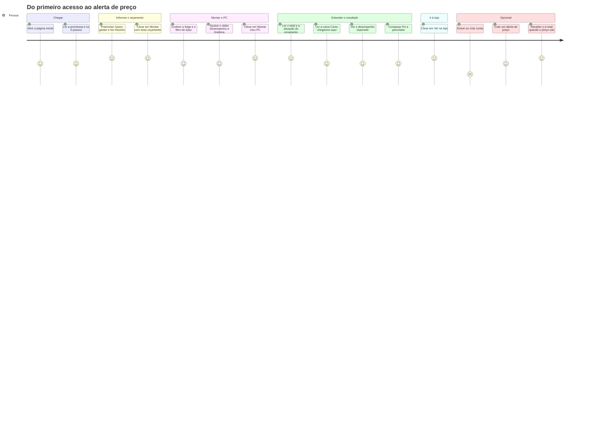
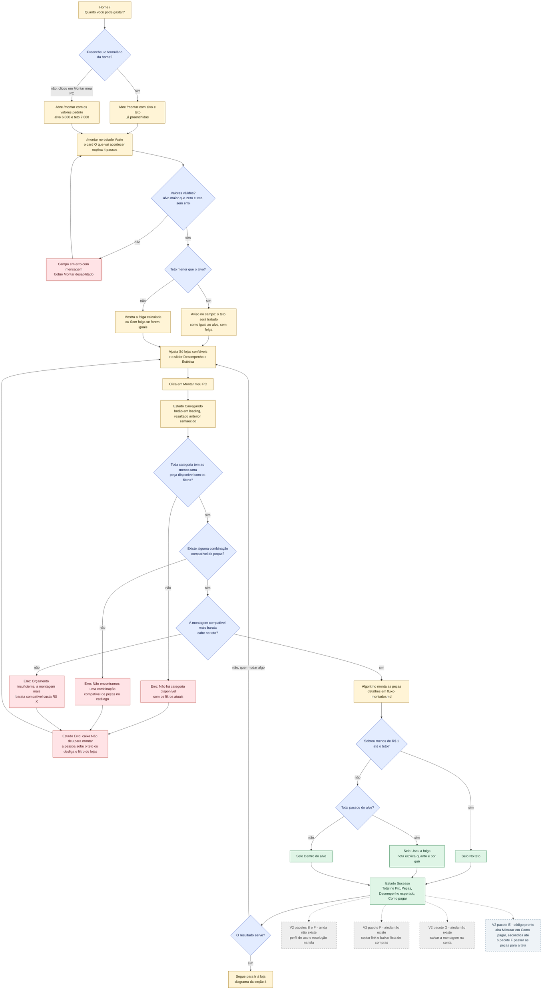
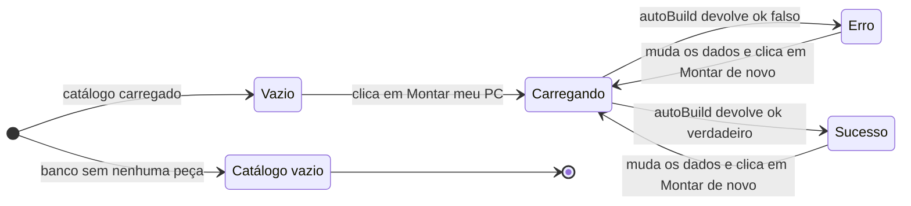
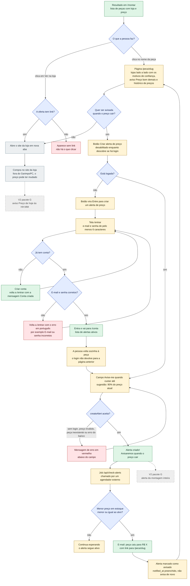

# Jornada da pessoa leiga

Quem é a pessoa: alguém que sabe **quanto quer gastar** (por exemplo, "6 mil, no máximo 7"),
mas não entende de hardware e tem medo de comprar peça errada ou cair em golpe
(ver `PRODUCT.md`). Esta página mostra o caminho dela, do primeiro clique até o alerta de
preço, **incluindo o que ela vê quando algo dá errado**.

Tudo aqui vem do código real: `src/app/page.tsx` (home), `src/app/montar/page.tsx` e
`src/components/builder/BuilderForm.tsx` (tela do Montador), `src/services/builder/auto-build.ts`
(erros do algoritmo), `src/app/peca/[slug]/page.tsx`, `src/components/PriceAlertButton.tsx`,
`src/app/entrar/page.tsx`, `src/app/conta/page.tsx` e `src/app/api/check-alerts/route.ts`.

> **Legenda de cores** nos fluxos: amarelo = tela, azul = decisão, vermelho = erro,
> verde = sucesso, cinza claro = site de fora, **cinza tracejado = V2 que ainda não existe**,
> **cinza-azulado tracejado = V2 com código pronto, mas ainda não ligado à tela**.

---

## 1. Visão geral da jornada

As notas (1 = frustrante, 5 = ótimo) são uma **hipótese de experiência** feita a partir do
desenho das telas, não uma medição com pessoas reais. A parte do login tem nota baixa de
propósito: é o ponto com mais atrito (ver "Pontos de atrito", no fim da página).

---

## 2. Do orçamento ao resultado (decisões e erros)

Este fluxo cobre as três decisões que mais importam para a pessoa leiga:

1. **Teto menor que o alvo** — o site corrige sozinho e avisa; não trava.
2. **Orçamento insuficiente** — o site diz quanto custa a montagem mais barata possível.
3. **Filtro de lojas** — "Só lojas confiáveis" ligado pode deixar uma categoria sem nenhuma peça.

### O que a pessoa vê em cada decisão

| Situação | O que acontece | Mensagem na tela | Onde no código |
|---|---|---|---|
| Teto menor que o alvo | Não bloqueia. O teto é tratado como igual ao alvo (folga zero) | "Teto menor que o alvo: vamos considerar o teto igual ao alvo (sem folga)." | `normalizeBudget` em `budget.ts`; dica no `BuilderForm` |
| Teto em branco | Usa o valor do alvo | "Sem folga: a montagem fica dentro do valor que você quer gastar." | `BuilderForm` |
| Alvo vazio, zero ou não numérico | Botão "Montar meu PC" desabilitado | "Informe um valor maior que zero." | `BuilderForm` (`alvoInvalido`) |
| Orçamento insuficiente | Não monta nada | "Orçamento insuficiente: a montagem mais barata compatível custa R$ 4.699,30. Suba o teto ou desative “Só lojas confiáveis”." (valor do catálogo de exemplo) | `autoBuild` (passo 2) |
| Filtro de lojas deixou uma categoria vazia | Não monta nada | "Não há fonte disponível com os filtros atuais. Desative “Só lojas confiáveis” ou tente mais tarde." (a categoria muda) | `autoBuild` (passo 1) |
| Sem filtro de lojas | Passa a aceitar ofertas de marketplaces, que costumam ser mais baratas e menos seguras | Em `/montar` a pessoa só vê o selo da loja (nota, "Oficial" e, ao passar o mouse, os motivos da confiança). O aviso "Preço bom demais?" já existe, mas só na página `/peca/[slug]` (V2 pacote C) | `cheapestOffer` em `trust.ts`; `flagSuspiciousOffers` em `suspicious.ts` |

---

## 3. Estados da tela `/montar`

A tela tem quatro estados normais mais um estado de falha do servidor. O cálculo roda **no
navegador** (`autoBuild` é chamado dentro do `BuilderForm`), por isso o estado "Carregando"
dura frações de segundo; ele existe para o botão e o resultado antigo não parecerem travados.

| Estado | O que a pessoa vê | Onde no código |
|---|---|---|
| Catálogo vazio | Caixa vermelha "Catálogo vazio" no lugar do formulário, mandando rodar os scripts da pasta `supabase/` | `src/app/montar/page.tsx` |
| Vazio | Card "O que vai acontecer" com os 4 passos do Montador | `EstadoVazio` em `BuilderForm.tsx` |
| Carregando | Botão em estado *loading*; o resultado anterior fica a 60% de opacidade; leitores de tela são avisados (`aria-live`) | `useTransition` em `BuilderForm.tsx` |
| Erro | Caixa vermelha "Não deu para montar" com o motivo; o botão passa a dizer "Montar de novo" | `BuilderForm.tsx` |
| Sucesso | Total no Pix, selo da situação, notas "Como chegamos aqui", Peças, Desempenho esperado e Como pagar | `BuildResultView.tsx` |
| Faixa "Modo de demonstração" | Aparece em qualquer estado quando o Supabase não está configurado: peças e preços são de exemplo | `usingRealData()` em `src/services/products.ts` |

---

## 4. Depois do resultado: ir à loja, login opcional e alerta

O login é **opcional** e só é necessário para criar alerta de preço. O alerta é **por peça**
(criado na página `/peca/[slug]`), não pela montagem inteira; o alerta da montagem inteira é
V2 (pacote G).

### Pontos de atrito observados no código

- **Depois de entrar, a pessoa cai em `/conta`**, não volta para a peça em que queria criar o
  alerta (`login` em `src/app/auth/actions.ts` sempre faz `redirect("/conta")`). Por isso a
  nota baixa no diagrama de visão geral.
- **Da home para `/montar` ainda falta um clique**: os valores digitados chegam preenchidos,
  mas a montagem só roda quando a pessoa clica em "Montar meu PC".
- **Sem filtro de lojas, `/montar` não avisa do risco** além do selo da loja. O aviso "Preço bom
  demais?" (oferta 25% ou mais abaixo da mediana das lojas confiáveis) já existe na página da
  peça, mas ainda não chega à tela do Montador.
- **Alertas já avisados continuam na lista de `/conta`**: a tela lista todos os alertas
  `is_active`, e o job só preenche `notified_at`, sem desativar o alerta.
- **Sem Supabase configurado** (modo de demonstração) não dá para entrar: `/entrar` mostra
  "O login ainda não está configurado" e `/conta` redireciona de volta para `/entrar`. O
  formulário continua visível, mas não há banco para autenticar.
