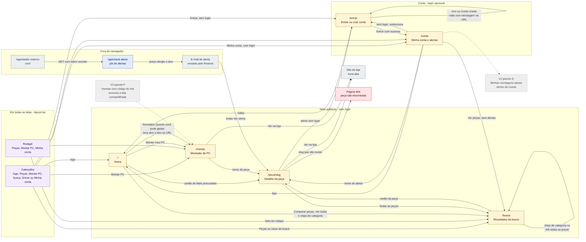

# Mapa de telas

Todas as rotas do GarimpoPC e como a pessoa navega entre elas. As rotas são as pastas de
`src/app/` (Next.js, App Router). Além das 6 páginas, existe 1 rota de API que **não é
navegada por pessoas**: `/api/check-alerts`, chamada por um agendador para mandar os e-mails
de alerta.

> **Legenda**: caixas amarelas = páginas, azul = job de fundo (sem tela), cinza claro = fora
> do GarimpoPC, **cinza tracejado = V2 (ainda não existe)**. O texto sobre cada seta diz qual
> elemento da tela leva até o destino.

## 1. Navegação entre as telas

## 2. O que cada tela mostra

| Rota | Para que serve | O que aparece | De onde vêm os dados | Estados especiais |
|---|---|---|---|---|
| `/` | Convencer a montar ou comparar | Promessa, formulário "Quanto você pode gastar?", 3 passos, "Mais procuradas" (6 peças), diferenciais | `getPopularProducts` em `popularity.ts` | Faixa "Modo de demonstração"; "Nenhuma peça cadastrada ainda" |
| `/busca` | Achar peças por nome, marca ou categoria (`?q=termo`) | Contagem, chips de categoria, grade de cartões com menor preço Pix e selo da loja | `searchProducts` em `products.ts` | Faixa de demonstração; "Nenhuma peça encontrada" com sugestão de termos |
| `/peca/[slug]` | Comparar lojas e ver o histórico | Melhor preço agora, botão de alerta, lojas do menor ao maior preço Pix (com parcelado e "Ver na loja"), gráfico de histórico | `getProductBySlug`, `getPriceHistory`; registra a visita com `registerView` | Slug inexistente vira 404; "Indisponível" por oferta; "Ainda não há histórico de preços" |
| `/montar` | Montar o PC dentro do orçamento (`?alvo=` e `?teto=` opcionais) | Painel de entradas, resultado (total, peças, desempenho, pagamento) | `getProducts`; a montagem roda no navegador (`autoBuild`) | Vazio, Carregando, Erro, Sucesso, "Catálogo vazio"; ver `jornada-usuario.md` |
| `/entrar` | Entrar ou criar conta (opcional) | E-mail, senha, botões Entrar e Criar conta | Ações `login` e `signup` em `src/app/auth/actions.ts` | `?erro=` (caixa vermelha), `?mensagem=` (caixa verde), aviso de login não configurado |
| `/conta` | Ver e remover alertas de preço | E-mail da pessoa, lista de alertas ativos (peça e preço-alvo), botão Sair | Tabela `price_alerts` com a sessão da pessoa | Sem login redireciona para `/entrar`; "Você ainda não tem alertas" |
| `/api/check-alerts` | Avisar por e-mail quando o preço cair | Nenhuma tela: devolve JSON `verificados` e `emails_enviados` | Tabelas `price_alerts`, `products`, `offers` (chave de serviço) | 401 sem o token; 500 sem a chave de serviço |

## 3. Ações de servidor (não são páginas)

São funções que rodam no servidor quando a pessoa envia um formulário. Não têm endereço
próprio e por isso não aparecem no mapa.

| Função | Arquivo | Chamada por | O que faz |
|---|---|---|---|
| `login` | `src/app/auth/actions.ts` | `/entrar` | Autentica; sucesso vai para `/conta`, erro volta a `/entrar?erro=` |
| `signup` | `src/app/auth/actions.ts` | `/entrar` | Cria a conta; volta a `/entrar?mensagem=` |
| `logout` | `src/app/auth/actions.ts` | `/conta` | Encerra a sessão e vai para `/` |
| `createAlert` | `src/app/account/actions.ts` | `PriceAlertButton` em `/peca/[slug]` | Grava em `price_alerts` (exige login) |
| `deleteAlert` | `src/app/account/actions.ts` | `/conta` | Remove um alerta da própria pessoa |

## 4. Peças que atravessam todas as telas

- **`src/app/layout.tsx`** monta o cabeçalho (`SiteHeader`), o rodapé (`SiteFooter`) e as
  fontes. O cabeçalho pergunta quem está logada (`getCurrentUser`) para trocar "Entrar" por
  "Minha conta".
- **`src/proxy.ts`** (o antigo "middleware" do Next.js 16) roda antes de cada requisição, exceto
  arquivos estáticos e imagens, só para renovar o cookie de sessão do Supabase. Sem Supabase
  configurado, ele não faz nada.
- **Modo de demonstração**: sem as chaves do Supabase, `/`, `/busca`, `/peca/[slug]` e `/montar`
  usam o catálogo de exemplo (`src/models/mock-data.ts`) e mostram uma faixa avisando.
