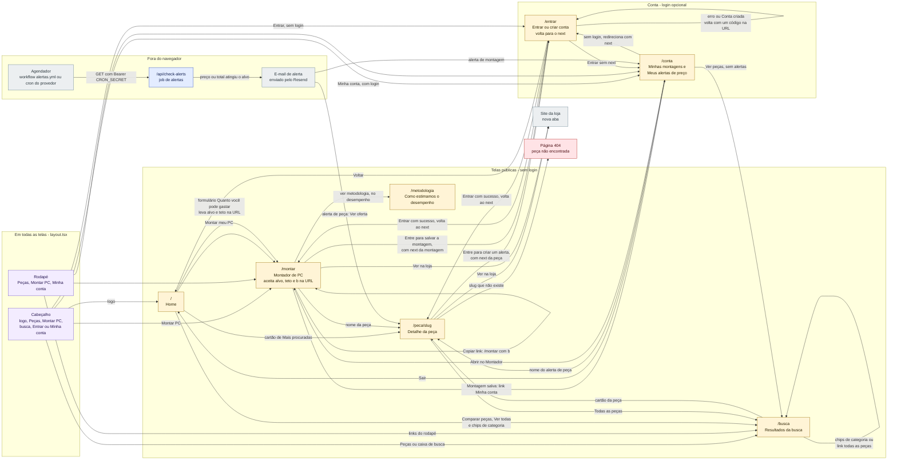

# Mapa de telas

Todas as rotas do GarimpoPC e como a pessoa navega entre elas. As rotas são as pastas de
`src/app/` (Next.js, App Router). Além das 7 páginas, existe 1 rota de API que **não é
navegada por pessoas**: `/api/check-alerts`, chamada por um agendador para mandar os e-mails
de alerta.

> **Legenda**: caixas amarelas = páginas, roxo = presente em todas as páginas, azul = job de fundo
> (sem tela), cinza claro = fora do GarimpoPC, vermelho = erro. O texto sobre cada seta diz qual
> elemento da tela leva até o destino.

## 1. Navegação entre as telas

## 2. O que cada tela mostra

| Rota | Para que serve | O que aparece | De onde vêm os dados | Estados especiais |
|---|---|---|---|---|
| `/` | Convencer a montar ou comparar | Promessa, formulário "Quanto você pode gastar?" (aceita valores quebrados, como 6.550), 3 passos, "Mais procuradas" (6 peças), diferenciais | `getPopularProducts` em `popularity.ts` | Faixa "Modo de demonstração"; "Nenhuma peça cadastrada ainda" |
| `/busca` | Achar peças por nome, marca ou categoria (`?q=termo`) | Contagem, chips de categoria, grade de cartões com o melhor preço Pix (a oferta "boa demais" é pulada) e selo da loja; aviso se só sobrar uma oferta suspeita | `searchProducts` em `products.ts` | Faixa de demonstração; "Nenhuma peça encontrada" com sugestão de termos |
| `/peca/[slug]` | Comparar lojas e ver o histórico | Melhor preço agora (nunca uma oferta "boa demais" nem de loja bloqueada), botão de alerta, lojas do menor ao maior preço Pix (com "ou Nx de R$ X" e "Ver na loja"), "Por que confiável" com os motivos de cada loja, aviso "Preço bom demais?", gráfico de histórico só com ofertas honestas | `getProductBySlug`, `getPriceHistory`, `getInstallmentTables`; registra a visita com `registerView` | Slug inexistente vira 404; "Indisponível" por oferta; "Ainda não há histórico de preços"; sem banco, "Alertas de preço precisam do banco configurado" |
| `/montar` | Montar o PC dentro do orçamento (`?alvo=`, `?teto=` e `?b=` opcionais) | Painel de entradas (alvo, teto, uso, resolução, filtro de lojas, slider) e resultado: total, selo, "Salvar montagem", "Copiar link", "Baixar lista (CSV)", "Como chegamos aqui", peças, desempenho (com "PCs parecidos com o seu" e link para a metodologia) e Como pagar (Pix, Parcelado e Misturar) | `getProducts`, `getPartSpecs`, `getReferenceBuilds`, `getInstallmentTables`; a montagem roda no navegador (`autoBuild`) | Vazio, Carregando, Erro, Sucesso, "Catálogo indisponível", "Sem especificações cadastradas", link inválido; ver `jornada-usuario.md` |
| `/metodologia` | Explicar de onde vêm o Índice GarimpoPC e os FPS estimados | O texto de `docs/METODOLOGIA-DESEMPENHO.md`, renderizado no servidor: o que foi estimado (nada foi medido pela GarimpoPC), a margem de erro e as fontes | Arquivo Markdown do repositório | — |
| `/entrar` | Entrar ou criar conta (opcional) | E-mail, senha, botões Entrar e Criar conta | Ações `login` e `signup` em `src/app/auth/actions.ts` | `?erro=` e `?mensagem=` são **códigos** traduzidos pela página (texto livre na URL é ignorado); aviso de login não configurado |
| `/conta` | Ver montagens salvas e alertas | E-mail da pessoa; "Minhas montagens" (nome, total no Pix, data, "Abrir no Montador", "Remover" e o alerta "Avisar quando a montagem custar até R$ X"); "Meus alertas de preço" (ativos e "avisado em DD/MM" com "Reativar"); botão Sair | Tabelas `saved_builds` e `price_alerts` com a sessão da pessoa | Sem login redireciona para `/entrar?next=/conta`; "Você ainda não tem alertas"; avisos de erro por código |
| `/api/check-alerts` | Avisar por e-mail quando o preço de uma peça, ou o total de uma montagem salva, cair | Nenhuma tela: devolve JSON com `verificados`, `emails_enviados`, `simulados` e `falhas` | Tabelas `price_alerts`, `saved_builds`, `products`, `offers` (chave de serviço) | **503** sem `CRON_SECRET`, sem a chave de serviço ou, em produção, sem `RESEND_API_KEY`; **401** com token errado |

## 3. Ações de servidor (não são páginas)

São funções que rodam no servidor quando a pessoa envia um formulário. Não têm endereço
próprio e por isso não aparecem no mapa. Todas as de `account/actions.ts` exigem login, e a RLS
do banco confere o dono de novo.

| Função | Arquivo | Chamada por | O que faz |
|---|---|---|---|
| `login` | `src/app/auth/actions.ts` | `/entrar` | Autentica; sucesso volta ao `next` (só caminho interno) ou vai para `/conta`; erro volta a `/entrar` com um código |
| `signup` | `src/app/auth/actions.ts` | `/entrar` | Cria a conta; volta a `/entrar` com a mensagem "conta criada" |
| `logout` | `src/app/auth/actions.ts` | `/conta` | Encerra a sessão e vai para `/` |
| `createAlert` | `src/app/account/actions.ts` | `PriceAlertButton` em `/peca/[slug]` | Grava um alerta de peça em `price_alerts` |
| `deleteAlert` e `reactivateAlert` | `src/app/account/actions.ts` | `/conta` | Remove um alerta, ou liga de novo um alerta já avisado |
| `saveBuild` | `src/app/account/actions.ts` | `SaveBuildButton` em `/montar` | Confere no banco que cada oferta é daquela peça, grava o preço de lá em `saved_builds` (até 50 por pessoa) |
| `deleteSavedBuild` | `src/app/account/actions.ts` | `/conta` | Remove uma montagem salva (e o alerta dela) |
| `createBuildAlert` | `src/app/account/actions.ts` | `/conta` | Cria ou troca o alerta da montagem inteira |

## 4. Peças que atravessam todas as telas

- **`src/app/layout.tsx`** monta o cabeçalho (`SiteHeader`), o rodapé (`SiteFooter`), o link
  "Pular para o conteúdo" e as fontes. O cabeçalho pergunta quem está logada (`getCurrentUser`)
  para trocar "Entrar" por "Minha conta".
- **`src/proxy.ts`** (o antigo "middleware" do Next.js 16) roda antes de cada requisição, exceto
  arquivos estáticos e imagens, só para renovar o cookie de sessão do Supabase. Sem Supabase
  configurado, ele não faz nada.
- **`next.config.ts`** acrescenta cabeçalhos de segurança a todas as respostas.
- **Modo de demonstração**: sem as chaves do Supabase, `/`, `/busca`, `/peca/[slug]` e `/montar`
  usam o catálogo de exemplo (`src/models/mock-data.ts`) e mostram uma faixa avisando.
